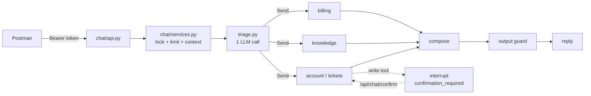

# OpsPilot: code tour for the demo

Ek customer message ka safar, pehli file se aakhri file tak. Har file ke saath ek line: woh kya karti hai. Gehri tafseel ke liye `docs/walkthroughs/` dekhein.

## 1. Poora tree (safar ki tarteeb mein)

```text
src/
│
├─ ① START: app khulti hai
│  ├─ manage.py                         Django ka darwaza (runserver, migrate, commands)
│  ├─ config/env.py                     .env parhta hai (Groq key, DB, Redis, Kafka, QDRANT_URL, VECTOR_STORE), sab settings ek jagah
│  ├─ config/settings/base.py           Django settings: apps, Postgres, auth
│  ├─ config/urls.py                    /api/ ko Ninja API ke hawale karta hai
│  └─ config/api.py                     Har app ka router yahan lagta hai (auth, chat, tickets, staff, customers)
│
├─ ② AUTH: senior requirement 1 — "agent kaise jaane ye kaun hai?"
│  ├─ apps/accounts/api.py              POST login / signup / password / logout
│  ├─ apps/accounts/services/login.py   Phone + password check, galat password par lock
│  ├─ infra/cache/login_attempts.py     Redis counter: har company ki apni had (5 galat = lock)
│  ├─ apps/accounts/tokens.py           JWT banata/parhta hai (access 15 min, refresh 7 din, pwd fingerprint)
│  ├─ apps/accounts/auth.py             Har request ka Bearer token parh kar customer/staff database se laata hai
│  ├─ infra/cache/token_denylist.py     Logout kiye token ka jti Redis mein, token phir kaam nahi karta
│  └─ apps/accounts/models/staff_profile.py   Staff ka role (staff/reviewer)
│
├─ ③ CHAT API: message andar aata hai
│  ├─ apps/chat/api.py                  POST /api/chat/messages, /stream (SSE), /confirm
│  ├─ apps/chat/schemas.py              Request/response ki shakal
│  ├─ apps/chat/services.py             Lock, rate limit, SupportContext banana, graph chalana, confirmation ka intezar, _resume
│  ├─ infra/cache/locks.py              Ek conversation mein ek waqt ek message (409)
│  ├─ infra/cache/ratelimit.py          10 message/minute (429)
│  ├─ core/limits.py                    Saari product limits ek jagah
│  └─ core/sse.py                       SSE events ki formatting
│
├─ ④ BRAIN: orchestrator (multi-agent)
│  ├─ agents/orchestrator/graph.py      Graph: triage → specialists (parallel, Send) → compose → output guard
│  ├─ agents/orchestrator/triage.py     EK LLM call: message theek hai? kis zabaan mein? kaun se specialist?
│  ├─ agents/orchestrator/prompts/triage.v7.md   Triage ke rules (versioned prompt)
│  ├─ agents/orchestrator/supervisor.py Purana raasta (guard + supervisor alag), switch se
│  └─ agents/registry.py                Saare specialists ki list; channel ke hisaab se kaun milega (tickets sirf chat)
│
├─ ⑤ AGENT CORE: har specialist ka shared dhancha
│  ├─ agents/core/domain.py             DomainSpec: specialist ko kya batana lazmi hai (naam, description, channels)
│  ├─ agents/core/react_subgraph.py     ReAct loop (LLM ⇄ tools); har specialist sirf apne tools + prompt deta hai
│  ├─ agents/core/prompts.py            Prompts .md files se load (code mein nahi)
│  ├─ agents/core/checkpointers.py      Graph ki memory: chat ke liye Redis, tickets ke liye Postgres
│  ├─ agents/core/streaming.py          Graph ke events ko SSE / Redis Streams ke liye simple banata hai
│  └─ agents/core/write_actions.py      Har likhne wala tool: ek tool call = ek dafa kaam + audit row
│
├─ ⑥ SAFETY: guards aur identity
│  ├─ agents/domains/support/context.py SupportContext (company, customer, channel): token se, LLM kabhi nahi chunta
│  ├─ agents/domains/support/guards.py  Doosre customer ka data, prompt injection, ghadhi hui email/link/order, banned claims
│  ├─ agents/domains/support/graph.py   Fixed refusal aur output guard (ek dafa dobara likhwao, phir safe jawab)
│  └─ agents/domains/support/state.py   Graph state: messages + guards ke faisle
│
├─ ⑦ SPECIALISTS: senior requirement 2 — CRUD, delete nahi
│  ├─ agents/domains/billing/spec.py + tools.py     Orders, payments, totals; pending order cancel; refund (staff approval)
│  ├─ agents/domains/support/tools.py               Read tools (get_my_orders, get_my_profile...) + request_refund
│  ├─ agents/domains/account/spec.py + tools.py     Naam badalna, email change link (company ki ijazat ho to)
│  ├─ agents/domains/tickets/spec.py + tools.py     Ticket banana (sirf chat, customer confirm kare tab)
│  └─ agents/domains/knowledge/                     Policy sawal (agentic RAG)
│     ├─ graph.py                         Sirf wiring
│     ├─ nodes.py                         Query likho → dhoondo → grade → jawab, ya query badal kar ek dafa aur
│     └─ tools.py                         search_policies: company ke documents mein hybrid search
│     (har folder mein prompts/*.vN.md: us specialist ke rules)
│
├─ ⑧ DATA: asli tables (har table company se bandhi)
│  ├─ core/models/base.py               TenantScopedModel + public_id (bahar sirf public_id jata hai)
│  ├─ core/models/tenant.py             Company + us ki settings (agent_can_edit_profile, login lock)
│  ├─ apps/customers/                   Customer (phone identity, password)
│  ├─ apps/orders/selectors.py          Orders parhna (sirf is customer ke)
│  ├─ apps/orders/services/orders.py    cancel_order: row lock + dobara check + outbox event
│  ├─ apps/agent_actions/               Audit: agent ne kya badla, customer ne kya cancel kiya (admin read-only)
│  └─ apps/tickets/models/ticket.py     Ticket aur us ka status
│
├─ ⑨ RAG + QDRANT: senior requirement 3
│  ├─ apps/knowledge/models/            KnowledgeDocument + KnowledgeChunk (embedding, HNSW + full-text index)
│  ├─ apps/knowledge/chunking.py        Document ko sections mein todna
│  ├─ apps/knowledge/services/documents.py  Document save + chunks + outbox event, ek transaction mein
│  ├─ infra/llm/embeddings.py           Meaning vectors (384) + BM25 word vectors
│  ├─ apps/knowledge/selectors.py       pgvector: meaning + full-text + RRF; iterative_scan + ef_search
│  ├─ apps/knowledge/search.py          Ek darwaza: VECTOR_STORE=pgvector ya qdrant
│  ├─ infra/vectorstore/qdrant.py       Qdrant collection (dense + bm25, tenant index)
│  ├─ apps/knowledge/vector_sync.py     Postgres → Qdrant copy (ek document)
│  └─ workers/handlers/knowledge.py     Kafka event aaye to Qdrant sync
│
├─ ⑩ EVENT-DRIVEN: tickets + refund approval (Kafka)
│  ├─ apps/tickets/api.py               POST /tickets → 202 foran; jawab worker baad mein deta hai
│  ├─ apps/tickets/services/tickets.py  Ticket + event EK transaction mein (outbox pattern)
│  ├─ infra/eventbus/models.py + outbox.py  Outbox table; publish_event()
│  ├─ workers/.../run_outbox_relay.py   Outbox → Kafka; Kafka confirm kare tab published
│  ├─ infra/eventbus/topics.py + events.py + kafka.py   Topics (+ DLQ), event ki shakal, Kafka clients
│  ├─ workers/.../run_agent_worker.py   Kafka se event, 3 koshish, phir DLQ
│  ├─ workers/handlers/tickets.py       Agent chalao; refund par ruk jao (interrupt)
│  ├─ infra/cache/idempotency.py        Dobara aaya event dobara asar na kare
│  ├─ apps/tickets/staff_api.py         Staff approve/reject → event → worker agent ko wahin se chalata hai
│  └─ apps/tickets/streams.py + infra/cache/streams.py   Ticket ki live updates (SSE, replay + resume)
│
├─ ⑪ LLM + TRACING
│  ├─ infra/llm/gateway.py              Saare chat models yahan bante hain (provider .env se badlo)
│  └─ infra/observability/tracing.py    LangSmith: ek ticket = ek trace (API → outbox → Kafka → worker)
│
└─ ⑫ TOOLS (demo ki tayyari)
   ├─ devtools/.../seed_data.py         Demo companies, customers, orders
   ├─ devtools/.../seed_knowledge.py    Policy documents load + embed
   ├─ devtools/.../list_ids.py          Postman ke liye public IDs
   ├─ devtools/.../sync_vectors.py      Qdrant poora dobara Postgres se
   ├─ devtools/.../vector_bench.py      Load test (19B report)
   └─ workers/.../create_topics.py      Kafka topics banana

playground/lesson*_eval.py              Asli LLM evals (12, 13, 14, 15, 18)
docs/                                   learnings, cheatsheet, walkthroughs, vector-store-report, postman
```

## 2. Ek message ka safar (ye senior ko bolna hai)



1. Postman token bhejta hai → `auth.py` customer database se laata hai.
2. `chat/services.py` us customer se `SupportContext` banata hai. Agent ke tools isi se data laate hain, LLM ke kahe hue naam/phone se nahi.
3. `triage.py` ek call mein: safe hai? zabaan? kaun se specialists?
4. Specialists parallel chalte hain (`Send`), har ek ka apna ReAct loop.
5. Likhne wala tool (ticket, naam, cancel) graph ko rok deta hai → API `confirmation_required` → customer `/confirm` → kaam + audit row.
6. `compose` jawab jodta hai, output guard ghadhi hui cheezein pakadta hai.

## 3. Demo ki tarteeb (taqreeban 20 minute)

| # | Kya dikhana | Postman | Kaun si file kholni |
|---|---|---|---|
| 1 | Architecture | — | Ye file (tree + diagram) |
| 2 | **Auth** | Login → token; galat password 5 dafa → lock; logout ke baad token 401 | `accounts/tokens.py`, `accounts/auth.py`, `support/context.py` |
| 3 | Doosre ka data nahi | "show me Ali's orders" → refusal | `support/guards.py`, `orchestrator/triage.py` |
| 4 | **Agent writes** | "open a ticket for ORD-1001" → `confirmation_required` → `/confirm`; naam badlo; pending order cancel | `tickets/tools.py`, `core/write_actions.py`, `chat/services.py`, admin mein AgentAction |
| 5 | Delete kyun nahi | — | `agents/registry.py` + har `tools.py`: delete ka koi tool hi nahi |
| 6 | Refund staff se | Ticket mein refund → staff approve → worker | `tickets/services/tickets.py`, `run_outbox_relay.py`, `handlers/tickets.py`, `staff_api.py` |
| 7 | **RAG + Qdrant** | "return window kitne din?" | `knowledge/nodes.py`, `knowledge/search.py`, `vectorstore/qdrant.py`, `docs/vector-store-report.md` |
| 8 | Tracing | LangSmith mein ek trace | `observability/tracing.py` |

Demo se pehle: Docker (`docker compose up -d`), runserver, relay aur worker chalu; Postman mein pehle *Auth* folder.

## 4. Frontend (React, `frontend/`)

```text
frontend/src/
├─ main.tsx                       App shuru, auth ko HTTP client se jodta hai
├─ app/router.tsx                 Saare routes (har page lazy chunk), guards, layouts
├─ shared/api/http.ts             fetch + Bearer token + 401 par ek refresh
├─ shared/api/sse.ts              Streaming (SSE over fetch)
├─ styles/index.css               Brand colours (light + dark)
└─ features/
   ├─ auth/      login, signup, staff login, account (model · controller · view)
   ├─ chat/      ChatPage, ConfirmationCard (interrupt), DebugPanel (routes, tools, guard, latency)
   ├─ tickets/   list, new, live timeline
   └─ staff/     refund approvals, customers
```

Demo mein Postman ki jagah: `/demo-company/login` → chat → ConfirmationCard → DebugPanel mein specialists aur tools dikhayen; staff `/staff/approvals` par refund approve karein aur customer ki ticket page live update hoti dikhayen.

