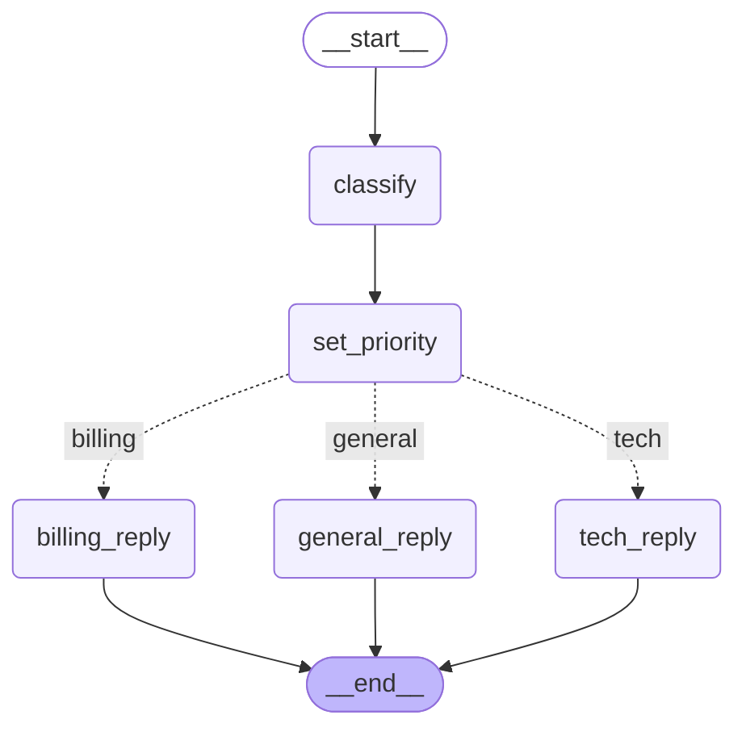

# Lesson 6 — Ticket triage graph

Generated by `graph.get_graph().draw_mermaid()` from `playground/lesson06_first_graph.py`. GitHub renders this block as a diagram; dotted arrows are conditional edges.

