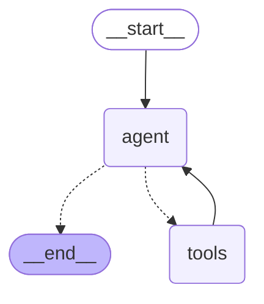

# Lesson 7B — ReAct tool agent

Generated by `graph.get_graph().draw_mermaid()` from `playground/lesson07b_tool_agent.py`. The `tools → agent` edge is the loop: after every tool call the agent sees the result and decides again.

