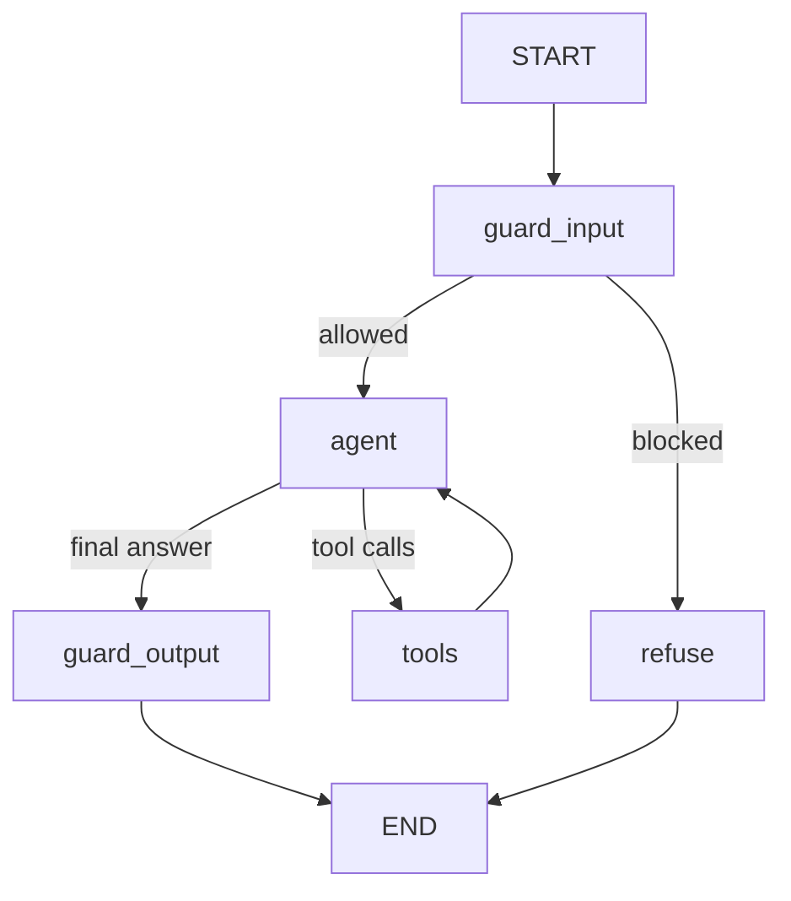
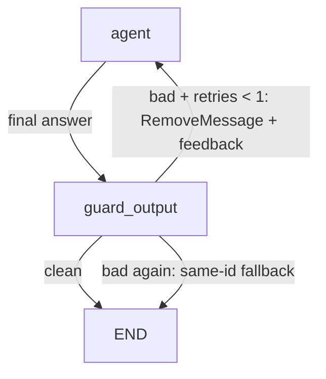
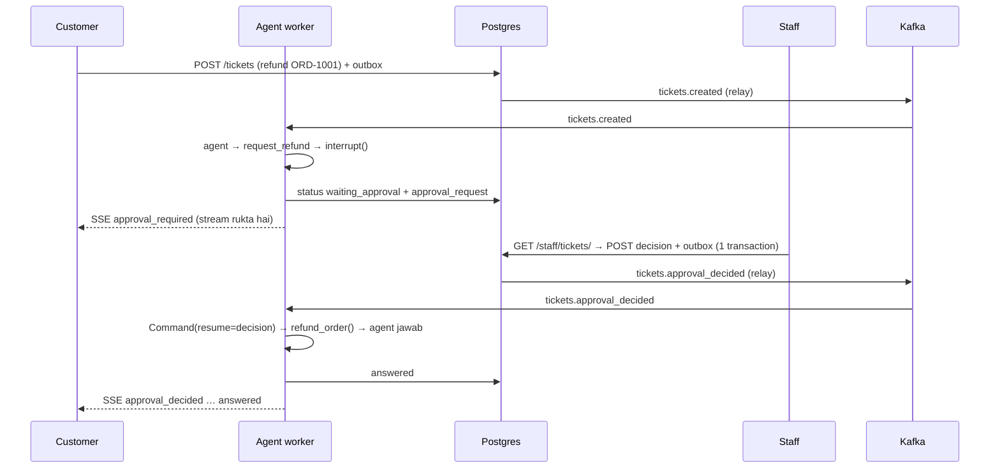
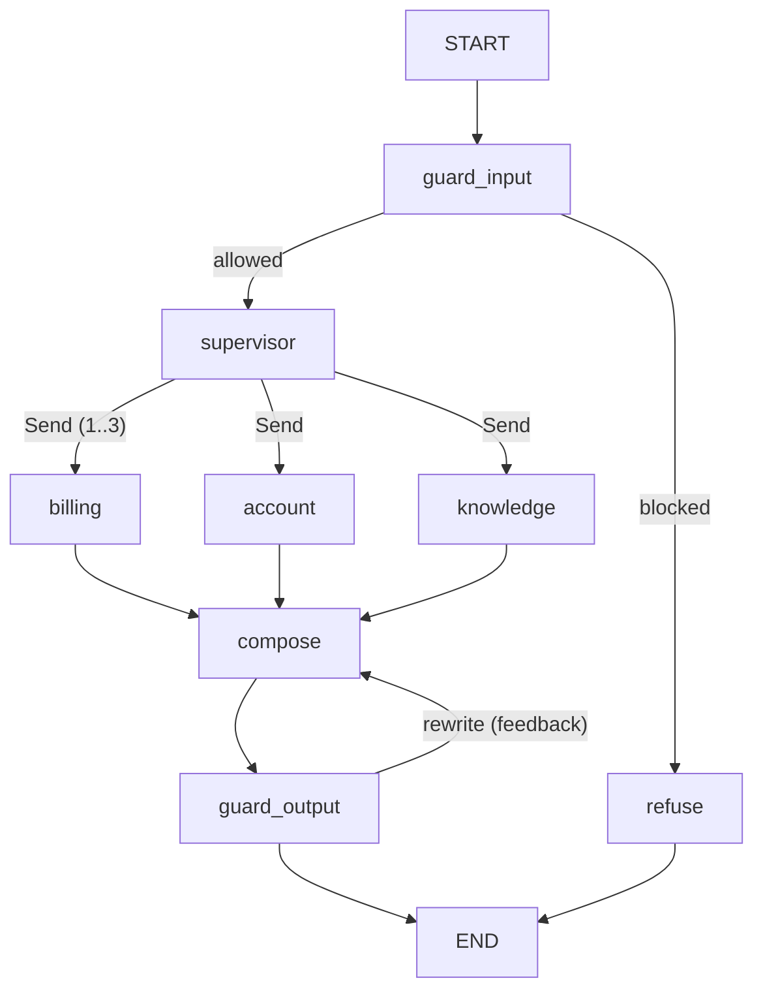
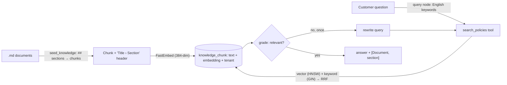

# OpsPilot — Meri Learnings

Har nayi cheez jo is project mein seekhi, yahan ek "Learning" ban kar likhi jati hai: kya hai, kyun zaroori hai, aur kaise check karein.

---

## Learning 1: Har repo ki apni Git identity

**Date:** 23 Oct 2026 · **Lesson:** 2 (Step 2.1)

### Kya hai?
Har git commit par ek **naam** aur **email** likha jata hai (author). GitHub isi email se commit ko aapke GitHub account se jorta hai.
- `pyproject.toml` ka `authors` sirf project ki maloomat hai — **commits par uska koi asar nahi**.
- Commit kis naam se hoga, ye `git config` decide karta hai.

### Do levels: global vs local
| Level | Command | Kahan save hota hai | Kis par lagta hai |
|---|---|---|---|
| **Global** | `git config --global user.email "..."` | `C:\Users\<user>\.gitconfig` | Computer ke **saare** repos |
| **Local** | `git config user.email "..."` (bina `--global`) | Repo ki `.git/config` | **Sirf yahi** repo |

Local, global se jeet jata hai. Isi liye office ke repos purani identity par rehte hain aur OpsPilot nayi identity par.

### Is project mein kya kiya
```bash
git config user.name "Malik Kashif Abbas"
git config user.email "malikkashifabbas28@gmail.com"
```

### Kaise check karein — is repo mein kaun si identity aur kaun sa GitHub juda hai
```bash
git config user.name                    # commits kis naam se honge
git config user.email                   # commits kis email se honge
git config --show-origin user.email     # ye value KIS FILE se aa rahi hai (local ya global)
git config --list --local               # sirf is repo ki saari settings
git remote -v                           # ye repo kis GitHub/remote repo se juda hai (khali = abhi kisi se nahi)
git log --format="%h %an <%ae>" -5      # pichle 5 commits kis naam/email se hue
```

### Yaad rakhne wali baatein
- Pehle commit se **pehle** identity check karein — baad mein purane commits ka author badalna mushkil hai.
- Jo email commits mein hai, wo GitHub account ki **Settings → Emails** mein added honi chahiye, warna commit aapki profile par nahi dikhega.
- `git remote -v` khali hai to repo abhi sirf aapke computer par hai; GitHub par push ke liye pehle `git remote add origin <url>` karna hoga.

---

## Learning 2: Settings ko base / dev / prod mein baantna

**Date:** 23 Oct 2026 · **Lesson:** 2B

### Kya hai?
Ek `settings.py` ki jagah ek **package** `src/config/settings/`:
| File | Kis ke liye | Khaas baat |
|---|---|---|
| `base.py` | Sab ki common settings | `DEBUG = False` — base hamesha **mehfooz** default |
| `dev.py` | Apna computer | `from .base import *` phir `DEBUG = True`, dev secret key |
| `prod.py` | Asal server | Secret key + hosts **environment variables** se, secure cookies |

### Teen cheezein jo seekhi
1. **`BASE_DIR` mein teesra `.parent`** — file ek folder neeche gayi (`settings/base.py`), to `src/` tak pahunchne ke liye ek `.parent` aur. Bhoole to DB file ghalat jagah banti hai. Sab se aam galti.
2. **Fail fast** — `os.environ["X"]` (square brackets) variable na mile to server **foran crash** (`KeyError`). `.get("X")` khamoshi se khali value de deta aur server ghalat chalta rehta.
3. **`setdefault`** — `manage.py` default `config.settings.dev`, `asgi.py`/`wsgi.py` default `config.settings.prod`; server par `DJANGO_SETTINGS_MODULE` env set ho to wahi jeetta hai.

### Kaise check karein
```bash
uv run src/manage.py diffsettings          # kaun si settings load hui (SETTINGS_MODULE, DEBUG, BASE_DIR)
uv run src/manage.py check --deploy        # production security checklist (prod settings ke saath)
```
PowerShell mein prod try karna:
```powershell
$env:DJANGO_SETTINGS_MODULE = "config.settings.prod"   # is terminal mein prod settings
Remove-Item Env:DJANGO_SETTINGS_MODULE                 # wapas dev
```

### `check --deploy` ki 3 warnings (deploy wale lesson mein theek hongi)
- **W004 HSTS** — browser ko batana ke site hamesha HTTPS par khole.
- **W008 SSL redirect** — HTTP request ko HTTPS par bhejna (ya load balancer kare).
- **W009 SECRET_KEY** — kam az kam 50 random characters, `django-insecure-` wali nahi.

---

## Learning 3: Docker Compose — Postgres, Redis, Kafka ek file se

**Date:** 23 Oct 2026 · **Lesson:** 3A

### `docker-compose.yml` kya hai (aur kya nahi)
- Ek **recipe** jo batati hai: kaun se containers, kaun si image + version, kaun se ports, kaun se env variables, data kahan (volumes), aur "zinda ho?" (healthcheck).
- Postgres/Redis/Kafka ki **sirf wo settings** jo env variables ya `command` se di jati hain. Har cheez nahi — Postgres ka andar ka tuning (`postgresql.conf`), Kafka ke topics, Redis ka data — ye sab apni jagah rehte hain.
- **Docker khud ki settings** (memory, CPU, disk) Docker Desktop ki Settings mein hain, is file mein nahi.
- Ek command `docker compose up -d` se poori team ka bilkul **same** setup — "mere computer par to chalta tha" khatam.

**Is file mein NAHI hota:**
| Cheez | Kahan hoti hai |
|---|---|
| Docker ki apni settings (RAM, CPU, disk) | Docker Desktop → Settings |
| Postgres ki andar ki tuning (memory, connections) | `postgresql.conf` (zaroorat ho to mount) |
| Database ki tables | Django migrations |
| Kafka ke topics | Code (`infra/eventbus/topics.py`) ya CLI |
| Redis ka data / keys | Redis ke andar, app likhti hai |
| Production setup | Kubernetes/ECS, ya managed services (AWS RDS, ElastiCache, MSK, Confluent Cloud) |

Compose file **local development** ke liye hai; production mein Postgres/Redis/Kafka aksar managed services hoti hain (backup, update, scaling cloud company karti hai).

### ⚠️ `POSTGRES_PASSWORD` sirf PEHLI dafa kaam karta hai
Postgres image user/password **sirf tab** banati hai jab volume khali ho (pehla `up`). Baad mein `.env` ka password badla → database ka password **nahi** badla → "password authentication failed".
Mere saath hua: pehla `up` ek password se hua, baad mein `.env` mein naya password likha, Beekeeper fail.
Do hal:
```bash
# 1) Database ke andar password badlo (data bacha rehta hai)
docker compose exec postgres psql -U opspilot -d opspilot -c "ALTER USER opspilot WITH PASSWORD '<naya-password>';"
# 2) Ya sab mita kar naye sire se (⚠️ saara DB data khatam) — sirf jab DB khali/bekaar ho
docker compose down -v
docker compose up -d
```
`.env` mein `#` wala password **quotes** mein rakho (`'abc#123'`), warna `#` ke baad wala hissa comment ban sakta hai. Database URL mein `#` ko `%23` likhna parta hai.

**Kaun sa password sach mein laga hai — check (Docker network se, asli password check ke saath):**
```bash
docker run --rm --network opspilot_default -e PGPASSWORD=<password> pgvector/pgvector:0.8.7-pg17 psql -h postgres -U opspilot -d opspilot -c "SELECT 1"
```
(`docker compose exec postgres psql -h 127.0.0.1 ...` se test mat karna — container ke andar se 127.0.0.1 "trust" hai, ghalat password bhi pass ho jata hai.)

### Ports: `"HOST:CONTAINER"`
`"5433:5432"` = Windows ka 5433 → container ka 5432. Ek port par ek hi program — mere Windows par pehle se native Postgres **5432** par tha, isliye Docker wala **5433**.

**Beekeeper / DBeaver se Docker Postgres:** Host `localhost`, Port **5433**, User `opspilot`, DB `opspilot`, password `.env` wala. Port 5432 likha to native Windows Postgres milega (uska user `postgres` hai) → "password authentication failed for user opspilot".

### Kafka ke "do darwaze" (listeners)
| Kaun connect kar raha hai | Pata |
|---|---|
| Docker network ke andar ka container (Kafka UI, baad mein workers) | `kafka:19092` |
| Windows par chalne wali app (Django, `uv run`) | `localhost:9092` |
Container ke andar `localhost` = **wahi container**, Windows nahi.

### Redis = temporary memory
```bash
docker compose exec redis redis-cli SET lesson3 "hello" EX 60   # 60 second ki zindagi
docker compose exec redis redis-cli TTL lesson3                 # kitne second baqi (Time To Live)
```

### Is lesson mein khud dekha
- **Bina key ke 5 messages → sab partition 2 mein.** Producer key na de to "sticky partitioner" ek batch ek hi partition mein daal deta hai. Key do (`ticket_id`) to `hash(key)` se partition tay hota hai — isi liye OpsPilot mein key lazmi.
- **Ghalat topic (`lesson3.typo`) par bheja → `UNKNOWN_TOPIC_OR_PARTITION`**, topic bana hi nahi. `AUTO_CREATE_TOPICS_ENABLE=false` ne typo pakar liya.
- **Redis key 60 second baad `TTL = -2`** — matlab key khud mit chuki (`-1` = key hai magar expiry nahi).

### Roz ki commands
```bash
docker compose up -d          # sab chalao (background)
docker compose ps             # haal + (healthy)
docker compose logs -f kafka  # ek service ke logs live
docker compose stop           # rok do, data safe
docker compose down           # containers hatao, volumes safe
docker compose down -v        # ⚠️ volumes bhi — saara DB data khatam
```
`restart: unless-stopped` — computer restart par containers khud chal jate hain, jab tak khud `stop` na kiya ho.

### Har service ki roz ki dekh-bhaal
| | Kya dekhte hain | Kaise |
|---|---|---|
| **Postgres** | Tables, data, slow queries | Beekeeper (5433), `psql`, Django admin. Schema sirf **migrations** se |
| **Redis** | Keys, TTL, memory | `redis-cli`: `SCAN 0 MATCH opspilot:*`, `TTL key`, `INFO memory` (visual: Redis Insight). Har key par TTL ho |
| **Kafka** | Topics, messages, **consumer lag** | Kafka UI (8080). Lag = kitne messages abhi process nahi hue; barhta jaye to workers peeche hain |

**Production mein:** monitoring (Grafana), Postgres ke automatic backups (asal sach Postgres mein; Redis/Kafka "rebuild ho sakne wala" data), topics code review ke baad, versions pinned aur upgrade test karke.

### Grafana kya hai?
Open-source **dashboard tool** — gaari ke dashboard (speed, petrol, temperature) jaisa, magar system ke liye.
- Khud data jama nahi karta; **data sources** se parhta hai: **Prometheus** (numbers/metrics jama karne wala time-series database), Loki (logs), Postgres waghera.
- Har service ka ek **exporter** uske numbers Prometheus ko deta hai: `postgres_exporter`, `redis_exporter`, `kafka-exporter`; Django/workers apne metrics khud dete hain.
- **Alerts:** "consumer lag 5 minute se 1000 se upar" → Slack/email/phone.
- OpsPilot ka dashboard: tickets/minute, LLM response time, LLM cost/din, Kafka consumer lag, Postgres connections, Redis memory.
- Hum isay observability wale lesson mein `docker-compose.yml` mein add karenge (Prometheus + Grafana).

---

## Learning 4: Django → Docker Postgres, `.env` se settings, pehli `migrate`

**Date:** 23 Oct 2026 · **Lesson:** 3B

### Raasta
```
.env ──► src/config/env.py (pydantic-settings: parho + type check) ──► settings/base.py DATABASES ──► psycopg ──► Postgres (localhost:5433)
```
Ek hi `.env` se Docker bhi password leta hai aur Django bhi — dono kabhi alag nahi honge.

### Nayi libraries
| Library | Kaam |
|---|---|
| `psycopg[binary]` (v3) | Python ↔ Postgres **driver**. `[binary]` = tayyar compiled (Windows par compiler nahi chahiye). LangGraph ka Postgres checkpointer bhi yahi use karta hai. `psycopg2` purana hai |
| `pydantic-settings` | Env variables + `.env` parhta hai **aur type check** karta hai; zaroori variable na mile to start par hi `ValidationError` (fail fast) |

### `env.py` ki khaas baatein
- Field `postgres_db` ↔ env `POSTGRES_DB` (chhote/bare huroof ka farq nahi).
- Default ho (`postgres_port: int = 5433`) to optional, warna **zaroori**. `: int` → `"5433"` khud number, `"abc"` par error.
- **Asal environment variable `.env` se jeet jata hai** — production mein `.env` hoti hi nahi.
- `SecretStr` → print/log par `**********`; asal value sirf `.get_secret_value()` se, sirf `DATABASES` mein.
- Alag `HOST/PORT/USER/PASSWORD` variables, ek `DATABASE_URL` nahi — URL mein `#`, `@`, `/` wale password toot-te hain.
- `DATABASES` **`base.py`** mein: dev/prod dono Postgres; sirf values alag, jo env se aati hain.

### Migrations
- **Migration** = database ki shakal (tables/columns) badalne wali Python file; database ke dhaanche ki "git history".
- `django_migrations` table = kaun si migration kab lagi. Django isi se jaanta hai kya baqi hai.
- Pehli `migrate` ne 18 migrations lagayin → 10 tables (`auth_*`, `django_*`).

### Commands
```bash
uv run src/manage.py check --database default   # sach mein DB se connect karke check
uv run src/manage.py showmigrations             # [ ] baqi, [X] lag chuki
uv run src/manage.py migrate                    # baqi migrations lagao
uv run src/manage.py createsuperuser            # admin user (password khud type karo)
```

### Is lesson mein khud dekha
- `uv add` ke dauraan chalta hua `runserver` crash hua: `ModuleNotFoundError: No module named 'pydantic'` — code ne nayi library import kar li thi magar install abhi poora nahi hua tha. Install ke baad dobara chalaya → theek.
- Migrate ke baad "You have 18 unapplied migrations" wali warning khatam.
- Admin login pehle fail: `createsuperuser` terminal mein username ke sawal par **ruki** hui thi, user bana hi nahi tha (`auth_user` khali). Sawalon ke jawab diye → user bana → login ho gaya.

### Password database mein kaise save hota hai
`auth_user.password` = `algorithm$iterations$salt$hash`, maslan `pbkdf2_sha256$1000000$<22 huroof salt>$<44 huroof hash>`.
- **Hash** = ek-tarfa hisaab: password se hash ban sakta hai, hash se password wapas **nahi**. Login par Django naye type kiye password ka hash bana kar milata hai.
- **Salt** = har user ka alag random tukda, taa ke do users ka same password ho to bhi hash alag ho (tayyar "rainbow tables" bekaar).
- **1,000,000 iterations** = hash 10 lakh dafa dohraya jata hai — login par ek pal, magar chori hua database "brute force" karne wale ke liye bohat mehenga.

---

## Learning 5 ⭐: Tenant, BaseModel, `id` vs `public_id` — OpsPilot ki bunyaad

**Date:** 23 Oct 2026 · **Lesson:** 4 · **Files:** `src/core/models/base.py`, `tenant.py`, `__init__.py`, `src/core/admin.py`

> Ye project ka **sab se zaroori** usool hai. Har naya model banate waqt ye page dobara parho.

### 1. Tenant kya hai aur itna zaroori kyun?
OpsPilot ek **SaaS** (Software as a Service) hai: **ek system, ek database, kai companies**. Har company (client) ek **tenant** hai — jaise ek building, kai kirayedar, har ek ka apna taala.

```
OpsPilot (ek database)
├── Tenant 1: "Hypernim"      → iske customers, tickets, invoices
├── Tenant 2: "NimbusTech"    → iske customers, tickets, invoices
└── Tenant 3: "Demo Company"  → ...
```

**Kyun zaroori:** ek company **kabhi bhi** doosri company ka data na dekh sake, na badal sake, na utha sake. Isliye:
- **Har table ki har row** par `tenant_id` hoga.
- **Har query** `WHERE tenant_id = <current tenant>` ke saath chalegi — API ho, admin ho, ya AI agent ka tool.
- **Har Kafka event** mein `tenant_id`; LangGraph `thread_id = "tenant:ticket"`; Store namespace `(tenant, "customers", id)`.
- Ek bhi query tenant filter bhool gayi = ek company ka data doosri ko — sab se bara security haadsa. Isliye har app mein `test_tenant_isolation.py` hoga.
- `tenant_id` **pehle din se** — baad mein lakhon rows wali tables mein add karna taqreeban naamumkin.
- Pehle dekha hua: MyCRMSim ka `workspace_id` / AI service ka `X-Workspace-ID` header = yahi tenant.

`Tenant` model (`core_tenant` table): `name`, `slug` (URL-safe, unique: `demo-company`), `is_active` (account band karna ho to delete nahi, `False` — soft disable).

### 2. BaseModel kyun? (abstract model)
Invoice, Ticket, Customer, Order… **alag cheezein**, magar har ek ko **same cheezein** chahiye: `public_id`, `created_at`, `updated_at` — aur har ek kisi **tenant** ka hai. Har model mein ye baar baar likhna = copy-paste + bhoolne ka khatra.

**Hal: abstract model** — khud **table nahi banata**, sirf apne fields wirasat (inheritance) mein deta hai:
```
BaseModel (abstract)               → public_id, created_at, updated_at   (+ id Django khud)
 ├── Tenant (asal table)            → + name, slug, is_active
 └── TenantScopedModel (abstract)   → + tenant  (ForeignKey → core.Tenant)
       ├── Customer  (aage)
       ├── Invoice   (aage)
       └── Ticket    (aage)  ← har ek ko tenant khud mil jayega
```
Naya model = `class Invoice(TenantScopedModel): ...` — tenant bhoolna **mumkin hi nahi**.
Saboot: 3 classes likhi, `makemigrations` ne sirf **1 table** (`core_tenant`) banayi — abstract ki table nahi banti (`class Meta: abstract = True`).

### 3. `id` aur `public_id` — dono kyun?
| | `id` (BigInt: 1, 2, 3…) | `public_id` (UUID: `ac5b565b-f62b-4806-…`) |
|---|---|---|
| Kahan | **Database ke andar** — joins, foreign keys (`tenant_id`) | **Bahar** — API URLs, Kafka events, frontend, logs jo client dekhe |
| Kyun | Chhota (8 bytes), tez, index halka | Andaza lagana naamumkin |
| Khatra agar bahar diya | `/tickets/5` → koi `/tickets/6` try kare (**enumeration attack**), aur kitne tickets hain wo bhi pata chal jaye | — |

**UUID** = Universally Unique Identifier. `id` Django khud banata hai (`DEFAULT_AUTO_FIELD = BigAutoField`), isliye model mein likha hi nahi.

### Har field ki khaas baat
| Code | Matlab / gotcha |
|---|---|
| `default=uuid.uuid4` (**bina bracket**) | Function khud diya, taa ke har row par naya UUID. `uuid.uuid4()` likhte to ek hi UUID **har row** ko milta |
| `unique=True` | Postgres khud unique index banata hai (tez dhoondna) |
| `editable=False` | Admin/forms mein badla nahi ja sakta |
| `auto_now_add=True` | Sirf banate waqt waqt likho |
| `auto_now=True` | Har `.save()` par naya waqt. ⚠️ `queryset.update()` par **nahi** badalta — khud `updated_at=timezone.now()` do |
| `ForeignKey("core.Tenant", ...)` | Text mein naam → circular import nahi. Postgres `tenant_id` par khud index banata hai |
| `on_delete=models.PROTECT` | Jab tak tenant ka data hai, tenant **delete nahi** ho sakta. `CASCADE` = tenant mita to saara data bhi mita — ek click mein company ka sab kuch gaya |
| `related_name="+"` | Ulta raasta (`tenant.invoice_set`) band — 50 tables ke naam nahi takrayenge; query hamesha bachche ki taraf se: `Invoice.objects.filter(tenant=...)` |
| ⚠️ `public_id` ka default **Python** mein hai, database mein nahi | Raw SQL `INSERT` se row banao to `public_id` khud dena parega |

### `models/__init__.py` ka gotcha
Django models `core.models` se dhoondta hai. Model `__init__.py` mein import na hua → `makemigrations` kahega "No changes detected".

### Migration ka safar (khud dekha)
```bash
uv run src/manage.py makemigrations core   # models → Python file 0001_initial.py (DB ko nahi chhuta)
uv run src/manage.py sqlmigrate core 0001  # asal SQL dikhao, chalao nahi — har migration se pehle dekhne ki aadat
uv run src/manage.py migrate               # SQL chalao → core_tenant table
```
SQL mein dekha: `"id" bigint ... GENERATED BY DEFAULT AS IDENTITY`, `"public_id" uuid NOT NULL UNIQUE`, `timestamp with time zone`, aur `slug` ke liye extra `varchar_pattern_ops` index (`LIKE 'demo%'` jaisi search tez).
Migration files **hamesha commit** hoti hain — poori team ke paas same tables.

---

## Learning 6: `serializers.py` vs `schemas.py` — aur humne Django Ninja kyun chuna

**Date:** 25 Oct 2026 · **Lesson:** 5 se pehle (sawal: "company ke project mein `serializers.py` hai, hamare mein kyun nahi?")

### ORM aur serializer — do alag tarjuman
```
Postgres ⇄ ORM / Model ⇄ SERIALIZER (schema) ⇄ JSON ⇄ frontend / doosri services
```
| | Kaam | Kis se baat |
|---|---|---|
| Model / ORM (`models/`) | tables ↔ Python objects | Database |
| Serializer / Schema | Python objects ↔ JSON + aane wale data ki jaanch | Bahar ki duniya (API) |

### Serializer/schema ke 3 kaam
1. **Output** — model → JSON, **sirf chune hue fields** (`public_id` haan; `id`, `tenant_id`, password hash kabhi nahi).
2. **Input validation** — ghalat/khali data database tak pahunchne se pehle hi `400 Bad Request`.
3. **Shakal badalna** — date format, fields jorna waghera.

### Do libraries, ek hi kaam
| | Django REST Framework (DRF) | **Django Ninja (hamara faisla)** |
|---|---|---|
| File | `serializers.py` | **`schemas.py`** |
| Bunyaad | DRF ki apni serializer classes | **Pydantic** |
| Async | Kamzor (`adrf` package chahiye) | Built-in |
| Docs | Browsable API | `/api/docs` par Swagger (OpenAPI) khud |
| Company ka project | `serializers.py` dikha = DRF | — |

⚠️ **Ninja DRF ke upar nahi bana** — bilkul alag library hai (FastAPI se mutasir), DRF install hi nahi hota. Dono ka maqsad same (REST API), tareeqa alag. DRF ka concept seekhne ke liye: `serializers.py` ≈ `schemas.py`, `ViewSet`/`APIView` ≈ Ninja `Router` ke functions.

### Ninja kyun chuna
- **Pydantic har jagah ek** — API schemas, `env.py` (pydantic-settings), aur LangGraph ka structured output/state — ek hi cheez teen jagah.
- **Async built-in** — LangGraph async hai, SSE streaming async hai.
- Type hints se validation + Swagger docs khud.
- Reliable: Django ke upar patli layer, Pydantic v2 (Rust core) — production mein bohat istemal.

### Usool (dono mein)
Schema ka kaam **sirf shakal + jaanch**. Business rules (refund kab allowed) **sirf `services/`** mein — DRF mein log `serializer.create()` mein logic likh dete hain, hum nahi.

```python
# schemas.py (Ninja)
from ninja import ModelSchema, Schema

class TenantOut(ModelSchema):      # bahar jane wali shakal
    class Meta:
        model = Tenant
        fields = ["public_id", "name", "slug", "is_active", "created_at"]

class TenantIn(Schema):            # andar aane wali shakal
    name: str
    slug: str
```

---

## Learning 7: App ka naqsha — har file dekhte hi kya soch aaye

**Date:** 25 Oct 2026 · **Lesson:** 5 (`customers` app, pehli API)

### App kya hai?
**App = ek business area ka apna ghar** (customers, billing, tickets). Us ki table, rules, queries aur APIs sab usi ke andar. Har app ki shakal **bilkul ek jaisi** — ek samajh liya, sab samajh aa gaye.

```
src/
├── config/        project ka control room (app nahi): settings, env.py, urls.py, api.py ⭐
├── core/          APP — shared bunyaad: BaseModel, Tenant, tenancy.py, exceptions.py
└── apps/
    └── customers/ APP — customers ka ghar
```

### Har file → dimagh mein kya aaye
| File | Soch |
|---|---|
| `models/` | 🗄️ table kaisi hai |
| `services/` | ✍️ data **likhne/badalne** ke rules (`INSERT/UPDATE/DELETE`) |
| `selectors.py` | 📖 data **parhne** ki queries (`SELECT`) — library ka catalog, kuch badalta nahi |
| `schemas.py` | 📦 API mein data ki shakal + jaanch (DRF ka `serializers.py`) |
| `api.py` (app ka) | 🚪 is app ke darwaze/routes (MyCRMSim: `routes/contacts/routes.js`) |
| `config/api.py` | ⭐ saare darwazon ki **main list**, har app ek line (MyCRMSim: `routes/index.js`) |
| `core/tenancy.py` | 🛂 gate ka guard: "ye request kis company ki hai?" |
| `exceptions.py` | ❌ is app ki errors (code + HTTP status) |
| `utils.py` | 🔧 sirf is app ke chhote helpers |
| `__init__.py` | 🏪 package ka counter — folder ko package banata hai, cheezein bahar deta hai |
| `__all__` | 📋 counter par rakhi cheezon ki official list |

### `tenancy.py` — guard
Har request ka pehla sawal: **kis company ki?** `TenantHeader` header `X-Tenant-ID` padh kar `Tenant` dhoondta hai; mila → **`request.auth`** = wo Tenant; na mila → **401**.
Use: `Router(..., auth=TenantHeader())` — ek line, router ke **har** route par guard. Abhi header (arzi); JWT lesson mein login token — sirf `tenancy.py` badlegi.

### `selectors.py` vs `services/`
Selector sirf **parhta** hai, service **likhti** hai. Alag isliye: dhoondna aasan, ek query kai jagah (API, AI agent tool, report) — tenant filter kabhi nahi bhoolta. Django ki built-in cheez nahi — **HackSoft Django Styleguide** ka mashhoor tareeqa.

### `__init__.py` aur `__all__`
- `customers/__init__.py` khali — "ye package hai".
- `models/__init__.py` — model counter par (warna Django model nahi dekhta).
- `services/__init__.py` — `from apps.customers.services import create_customer` (andar file badle to bhi bahar ka import same).
- **Pydantic se koi talluq nahi** — ye Python ki apni cheezein hain.
- App ko **Django** start karta hai: `INSTALLED_APPS` mein `'apps.customers'` → `__init__.py` (darwaza) → `apps.py` (`name = 'apps.customers'`) → `models/`.

### Lesson 5 ke khaas sabaq
- ⭐ **Multi-tenant mein har unique rule mein `tenant`**: `UniqueConstraint(fields=["tenant", "phone"])`. Sirf `phone` unique hota to doosri company us number ka customer na bana pati — aur error se pata chal jata ke number kisi aur ke paas hai (leak).
- **Duplicate database ka constraint pakarta hai**, `exists()` check nahi — do requests ek pal mein aayein to dono `exists()` "nahi" kahenge (race condition). `IntegrityError` → `CustomerAlreadyExists` (409).
- **`get_customer` mein `tenant` filter** — UUID leak ho sakta hai; doosri company ko **404** (403 bhi nahi, warna pata chalta ke customer hai). UUID chhupata hai, tenant filter bachata hai.
- **`CustomerIn` mein `tenant` field nahi** — client tenant nahi chun sakta; sirf header/token se.
- `startapp` ka `name = 'customers'` → **`'apps.customers'`** (app `apps/` ke andar hai).
- Errors ka ek format: `DomainError` (`code` + `status_code`) + `config/api.py` ka `@api.exception_handler` → `{"code": "...", "message": "..."}`.
- Swagger docs khud: **http://127.0.0.1:8000/api/docs** (Authorize → `X-Tenant-ID`).

### Test natije (25 Oct 2026)
| # | Test | Natija |
|---|---|---|
| 1 | Ali Khan banao (`+92 300-123 4567`) | **201**, phone `+923001234567` (saaf), `id`/`tenant` jawab mein nahi |
| 2 | Wahi phone dobara (spaces ke bagair) | **409** `CUSTOMER_ALREADY_EXISTS` |
| 3 | Email `ali@` | **422** "There must be something after the @-sign" (Pydantic) |
| 4 | Bina header / kachra header | **401** |
| 5 | List (Demo Company) | **200** `{"items": [Ali], "count": 1}` |
| 6 | Ali by `public_id` (Demo Company) | **200** |
| 7a | List (NimbusTech) | **200** `{"items": [], "count": 0}` — Ali nazar nahi aaya ✅ |
| 7b | Ali by sahi `public_id` (NimbusTech) | **404** ✅ |
| 7c | Wahi phone NimbusTech mein | **201** — ek insaan, do companies, koi takrao nahi ✅ |

### ⚠️ Docker ka sabaq (aaj hua)
- Computer restart ke baad Docker Desktop band → Postgres nahi → `makemigrations` / Django shell **atak** gaye (error bhi nahi diya). Pehla shak hamesha: `docker compose ps`.
- Docker Desktop ko terminal tab se `& '...Docker Desktop.exe'` se chalaya, phir tab band kiya → **Docker bhi band** (tab ke saath us ka chalaya process bhi mar jata hai). Sahi: `Start-Process '...Docker Desktop.exe'` (alag process) ya Start Menu se.
- Docker Desktop → Settings → General → **"Start Docker Desktop when you sign in"** on kar do, phir restart ke baad khud chalega.
- `docker compose up -d --wait` — containers ke **healthy** hone tak ruk kar hi wapas aata hai.

---

## Learning 8 ⭐: LangGraph ki bunyaad — state, node, edge, reducer

**Date:** 26 Oct 2026 · **Lesson:** 6 · **File:** `playground/lesson06_first_graph.py` · **Diagram:** `docs/graphs/lesson06_ticket_triage.md`

### Factory ki misaal
```
            WHITEBOARD (State): ticket_text, category, priority, reply, steps
START ──► [classify] ──► [set_priority] ──┬──► [billing_reply] ──► END
                                           ├──► [tech_reply]    ──► END
                                           └──► [general_reply] ──► END
```
| Lafz | Misaal | Matlab |
|---|---|---|
| **State** | Whiteboard | `TypedDict` — shared dictionary, poore kaam ka haal |
| **Node** | Mazdoor | Python function: state **parhta** hai, sirf **apna hissa** (update) wapas karta hai |
| **Edge** | Conveyor belt | `add_edge(a, b)` — "a ke baad hamesha b" |
| **Conditional edge** | Signboard | `add_conditional_edges(node, route_fn, path_map)` — route function naam lautata hai, path map us naam ko asal node se jorta hai |
| **Reducer** | Likhne ka qaida | Default = **badal do**; `Annotated[list, operator.add]` = **jor do** |
| **START / END** | Darwaze | Shuru / khatam |
| **compile()** | Inspection | Graph check karke chalne ke qabil banata hai |
| **invoke()** | Line chalao | Shuru ka state do → **aakhri** state lo |
| **stream(stream_mode="updates")** | CCTV | Har node ke baad **sirf us ka update** — OpsPilot mein yahi SSE se browser tak jayega |

### Sab se zaroori usool
- Node **poora state nahi**, sirf jo badla wo `return` karta hai: `return {"category": "billing", "steps": [...]}`.
- **Reducer** chat agents ki jaan hai — aage `messages` isi tarah jurenge (`add_messages`).
- Routing function **node nahi** — state mein kuch nahi likhta, sirf agla raasta batata hai.

### Khud chala kar dekha (26 Oct 2026)
| Test | Natija |
|---|---|
| invoke: "I was charged twice, please refund ASAP" | `billing`, `high`, billing reply, `steps` = `['classify -> billing', 'set_priority -> high', 'billing_reply']` (3 nodes ka record) |
| stream: "The app shows an error on login" | 3 updates: `classify` → `tech`, `set_priority` → `normal`, `tech_reply` |
| Mermaid | Dotted arrows (`-. billing .->`) = conditional, seedhe (`-->`) = normal; GitHub par diagram ban jata hai |
| **Tajurba 1:** reducer hataya (`steps: list[str]`) | `steps` = sirf `['billing_reply']` — har node ne pichla **mita** diya |
| **Tajurba 2:** path map hataya | ⚠️ **Koi error nahi!** Warning: `wrote to unknown channel branch:to:billing, ignoring it` — route ne `"billing"` lautaya, is naam ka koi node nahi, to graph **chupchaap ruk gaya**, reply bana hi nahi. Mermaid bhi ghalat: `set_priority --> __end__`. Sabaq: route ke jawab hamesha **asal node naam** hon ya path map do — warna khamosh bug |
| **Tajurba 3:** "My account is locked, urgent!" | `general`, `high` — "locked" keyword list mein nahi tha. Keyword rules kamzor hain → **Lesson 7 mein LLM** |

### ⚠️ Gotcha: LangGraph node ki type hint bhi parhta hai
Node function `def classify(state: TicketState)` ki hint se LangGraph us node ka **input schema** banata hai. Ek hi `steps` field do alag types (reducer ke saath aur bagair) mein aaye to: `ValueError: Channel 'steps' already exists with a different type`. Har graph ke nodes ki hints usi graph ki state se milni chahiyein.

---

## Learning 9 ⭐: Graph mein LLM, structured output, tools aur ReAct agent

**Date:** 26 Oct 2026 · **Lesson:** 7 · **Files:** `src/infra/llm/gateway.py`, `playground/lesson07a_llm_classify.py`, `playground/lesson07b_tool_agent.py` · **Diagram:** `docs/graphs/lesson07b_tool_agent.md`

### LLM provider: Groq Cloud (free)
- **Groq** (q) = cloud jo open models tez chalata hai, free tier bina card. **Grok** (k) = xAI ka model, alag cheez.
- Model: `groq:openai/gpt-oss-120b` (achhi tool calling). Free hadd (model ke hisaab se, account ke Limits page par dekho) ≈ 30 req/min, 1,000 req/din, 200,000 tokens/din — ek agent run ≈ 2–4 hazaar tokens.
- Free tier par **asli customer data kabhi nahi**.

### LLM gateway — `src/infra/llm/gateway.py` (project ka pehla `infra/` hissa)
- `get_chat_model()` — har agent yahi bulata hai; `init_chat_model("groq:...")` provider dekh kar sahi class (`ChatGroq`) banata hai. Provider badalna = `.env` mein `LLM_MODEL` ki ek line.
- `temperature=0` — har dafa ek jaisa, soch samajh kar jawab (classification/support ke liye).
- Key na ho to `LLMNotConfigured` — saaf error.
- **`config/env.py`:** `llm_api_key: SecretStr | None` — **optional**, taa ke key na ho to bhi `migrate`/`runserver` chalein (ek feature ki kami poori app na giraye). `AliasChoices("LLM_API_KEY", "GROQ_API_KEY")` — dono naam chalte hain (meri `.env` mein `Groq_Api_Key` hai; case-insensitive).
- ⚠️ pydantic-settings `.env` parhta hai, magar provider SDKs `os.environ` dekhte hain → key `api_key=` se **khud** pass ki.

### Messages
| Message | Kaun | Misaal |
|---|---|---|
| `SystemMessage` | Developer ki hidayat | "You are OpsPilot's support agent..." |
| `HumanMessage` | Customer | "I paid for ORD-1002 but it shows unpaid" |
| `AIMessage` | LLM | text jawab **ya** tool call `get_order_status(order_id="ORD-1002")` |
| `ToolMessage` | Tool ka nateeja | "unpaid, payment failed (card declined)" |

### 7A — Structured output
`get_chat_model().with_structured_output(Classification)` → LLM **majboor** ke Pydantic shakal mein jawab de; seedha `result.category`. `Field(description=...)` **LLM ko dikhti hai** — yahi asal hidayat hai ("tech = errors, login, account access").

| Ticket | Lesson 6 (keywords) | Lesson 7A (LLM) |
|---|---|---|
| "My account is locked, urgent!" | ❌ general | ✅ **tech + high** — "account is locked and urgent, indicating blocked access" |
| "I was charged twice for my subscription" | billing | ✅ billing + normal |
| "Do you have a dark mode?" | general | ✅ general + normal |

### 7B — Tools aur ReAct loop
```
START ──► [agent] ──tool call?──► [tools] ──► (wapas agent)
              └──── nahi ──► END
```
- `@tool` → LLM ko **naam + docstring + parameters** dikhte hain. **Docstring = LLM ki hidayat** ke tool kab chalana hai.
- `llm.bind_tools(TOOLS)` — LLM ko tools ki list; LLM tool **khud nahi chalata**, sirf call deta hai.
- `ToolNode(TOOLS)` — call parh kar function chalata hai, `ToolMessage` likhta hai.
- `tools_condition` — aakhri AIMessage mein tool call → `"tools"`, warna END.
- `add_edge("tools", "agent")` — **loop**: nateeja dekh kar agent phir sochta hai (ek se zyada tools bhi).
- `MessagesState` — tayyar state, `messages` + `add_messages` reducer (naya message jud jata hai).
- **ReAct = Reason + Act.** Yahi OpsPilot ke har domain agent (billing, tech) ka dhaancha hoga.

### Khud chala kar dekha (26 Oct 2026)
| Sawal | Kya hua |
|---|---|
| "Paid ORD-1002 but shows unpaid" | 1 tool call `get_order_status(ORD-1002)` → "card declined" → sahi jawab, kuch ghadha nahi ✅ |
| "Can't log in, ali@example.com, also check ORD-1001" | **2 tool calls ek ke baad ek** (`get_account_status` → `get_order_status`) → dono baatein ek jawab mein ✅ — loop ka saboot |
| "What are your office hours?" | ⚠️ **Koi tool nahi, aur agent ne "Mon–Fri 9am–6pm EST" khud GHADH diya** (hallucination). Prompt sirf "order/account details mat ghadho" kehta tha. Sabaq: LLM jo nahi jaanta wo bana leta hai → **guardrails + knowledge tool (RAG, aage)** chahiye; prompt mein "jo tools se na mile, kaho mujhe pata nahi" |
| Test call `invoke("Reply with exactly: pong")` | `pong`, 121 tokens (35 "reasoning" tokens — gpt-oss andar sochta hai) |

### Terminal mein agent se chat — `playground/chat_agent.py`
```bash
uv run python playground/chat_agent.py     # 'new' = nayi chat, 'exit' = band
```
- Har sawal par **poori pichli history + naya sawal** graph ko diya jata hai, isliye follow-up ("what about my **other** order ORD-1001?") samajh aata hai.
- `new` ke baad history khali → agent: "I don't have any record of a previous question" — **memory sirf wahi hai jo hum usay dete hain**; LLM khud kuch yaad nahi rakhta.
- Abhi history hum **khud** Python list mein sambhal rahe hain. Lesson 8 mein **checkpointer** + `thread_id` ye kaam khud karega (aur server restart ke baad bhi yaad rakhega).

### Meri apni chat se sabaq: "agent sirf wahi kar sakta hai jo tools allow karein"
Maine poocha "give me all my orders, kaun complete kaun nahi". Agent ne IDs maangi, phir email; `ali@example.com` diya to sirf account status bataya, orders ki list nahi di; "mujhe email nahi pata" kaha to mana kar diya.
- **Wajah:** sirf 2 tools the — order **ID** se status, aur **email** se account status. "Is customer ke saare orders" wala tool **tha hi nahi** — agent wo kaam kar hi nahi sakta tha.
- **Achhi baat:** usne orders **ghadhe nahi** (office hours ke ulat), aur bina pehchaan ke data dene se **inkaar** kiya — sahi security rawaiya.
- **Asal OpsPilot mein:** customer ticket ke saath hi pehchana hota hai (tenant + customer, login/token se) — agent ko email poochne ki zaroorat nahi. Tool hoga `list_orders_for_customer()` jo **request ke customer aur tenant tak band** ho; customer ID LLM se nahi, system se aaye (warna koi "mujhe kisi aur ke orders dikhao" keh sakta hai).
- **Tool design = agent ki salahiyat + hifazat.** Kaun se tools, kis input ke saath, kis data tak — yahi tay karta hai agent kya kar sakta hai aur kya nahi.

---

## Learning 10 ⭐: Checkpointer — agent ki yaadasht (`thread_id`, InMemory, Postgres)

**Date:** 26 Oct 2026 · **Lesson:** 8 · **Files:** `src/agents/core/checkpointers.py`, `playground/lesson08a_memory.py`, `playground/chat_agent.py`

### Concepts
- **Checkpoint** = har node ke baad state ki **photo** (video game ka save point).
- **`thread_id`** = ek baat-cheet ki ID; har thread ki apni photos. `config = {"configurable": {"thread_id": "ali-1"}}`.
- Checkpointer ke saath har dafa **sirf naya message** bhejo — purana checkpointer aakhri photo se nikaal kar `add_messages` se jorta hai.
- `builder.compile(checkpointer=...)` — yahin graph ko yaadasht milti hai (`None` = bina yaadasht).
- `graph.get_state(config)` — aakhri photo: `.values` (state), `.next` (agla node; `()` = kaam khatam).
- `graph.get_state_history(config)` — saari photos (naye se purane) → **time travel** ki bunyaad.
- OpsPilot mein `thread_id = "tenant:ticket"` — tenant shamil, taa ke ek company doosri ka thread na khol sake.

| Checkpointer | Kahan | Restart ke baad | Kab |
|---|---|---|---|
| `InMemorySaver` | RAM | ❌ bhool jata | Seekhna, tests |
| `PostgresSaver` | Postgres | ✅ yaad | Tickets, approvals (lambi, audit) |
| `RedisSaver` + TTL | Redis | ✅ TTL tak | Chhoti chat memory (Lesson 8C) |

### `src/agents/core/checkpointers.py` (pehla `agents/` code)
- `postgres_url()` — `.env` se URL; `quote(password, safe="")` → `#` jaise huroof `%23` (Lesson 3A wala sabaq code mein).
- `@contextmanager postgres_checkpointer()` — connection khulta hai, kaam, phir **khud band** (error mein bhi).
- `saver.setup()` — LangGraph ki apni 4 tables: `checkpoints`, `checkpoint_blobs`, `checkpoint_writes`, `checkpoint_migrations` (idempotent). ⚠️ Ye **Django migrations se nahi** — Django models mein kabhi nahi; production mein alag command se ek dafa.
- Library: `langgraph-checkpoint-postgres 3.2.0` (+ `psycopg-pool`), wahi psycopg 3.

### Khud chala kar dekha (26 Oct 2026)
**8A (InMemory):**
| Thread | Sawal | Nateeja |
|---|---|---|
| ali-1 | "Hi, my email is ali@example.com" | Agent ne **khud** tool chala diya → locked |
| ali-1 | "Why can't I log in?" (email nahi diya) | ✅ yaad tha — "five consecutive failed attempts" (dobara tool bhi nahi chala, purana nateeja yaad) |
| sara-1 | "Why can't I log in?" | ❌ email maanga — alag thread, alag yaadasht |
`ali-1`: 6 messages, **8 checkpoints**, `next = ()`.

**8B (Postgres, alag processes):**
- RUN 1 `--thread demo-ali`: email diya → `exit` (process khatam).
- RUN 2 **naya process**, same thread: "(continuing an old conversation: 4 saved messages)" → "why can't I log in?" → ✅ sahi jawab, email yaad. `state`: 6 messages, 8 checkpoints.
- RUN 3 `--thread demo-sara`: email maanga.
- Postgres: `demo-ali` = 8 checkpoints, `demo-sara` = 3.

### ⚠️ Naya chhota masla dekha
Agent ne kaha "**we can unlock it for you**" — jabke unlock ka koi tool hai hi nahi. Ye **salahiyat ki hallucination** hai (wada jo poora nahi kar sakta). Hal: prompt mein "sirf wahi kaam offer karo jo tools se ho sake", aur aage asli `unlock_account` tool **approval (`interrupt`) ke saath**.

### Chat script ab
```bash
uv run python playground/chat_agent.py                  # RAM (exit par bhool jata)
uv run python playground/chat_agent.py --thread ali-1   # Postgres (restart ke baad yaad)
```
`new` = naya thread, `state` = saved messages + checkpoints, `exit` = band.

### Meri chat (thread `kashif-1`) se do sabaq
1. **"sara@example.com database mein nahi, phir agent ne kaise bataya?"** — Agent ke tools **database nahi** parhte; `playground/lesson07b_tool_agent.py` ki Python dictionaries (`FAKE_ORDERS`, `FAKE_ACCOUNTS`, line 19–20) parhte hain. Chat ke shuru mein `Test data -> ...` isi nakli data ki list hai. Database mein **orders ki table hi nahi** hai. Tools ko asli tables (`customers_customer` + nayi orders table, tenant ke saath) se jorna agla kaam hai.
2. **"tell me email" → agent ne `support@opspilot.com` ghadh diya** — sawal mubham tha, agent ne "company ka email" samjha aur jo nahi jaanta tha wo **bana diya** (office hours jaisi hallucination). Wazahat ke baad yaadasht se sahi `sara@example.com` bataya — memory theek kaam kar rahi thi. Hal: prompt mein "jo tools/yaadasht se na mile, wo mat banao; mubham sawal par wazahat poocho".
- `exit()` command nahi — sirf `exit` likhna hai; `exit()` agent ko message ban kar chala gaya.

---

## Learning 11: Har folder mein `__init__.py` kyun — ek kaafi kyun nahi?

**Date:** 26 Oct 2026 · **Sawal:** "`__init__.py` mein code hi nahi, to har folder mein kyun? Ek poore project mein kaafi nahi?"

- **Package hona har folder ka apna mamla hai, project ka nahi.** Root ka `__init__.py` sirf root ko package banata hai — neeche wale folders ko nahi.
- Python 3.3+ mein bina `__init__.py` folder bhi import ho jata hai — use **namespace package** kehte hain (PEP 420). Isliye "chal to jata hai" — magar ye cheezein tootti hain:

| Kahan | Bina `__init__.py` kya hota hai |
|---|---|
| ⚠️ **Django `migrations/`** | Django isay "namespace" samajh kar app ko **unmigrated** maan leta hai — migrations chalengi hi nahi, chupchaap |
| Tests (`unittest` discovery, pytest) | Tests dhoonde nahi jate; do folders mein same naam ki test file (`test_api.py`) ho to pytest "import file mismatch" |
| mypy / ruff | mypy ko alag setting chahiye; ruff ka rule INP001 "implicit namespace package" warning deta hai |
| Naam ka takrao | Do alag jagah same naam ka folder ho to namespace package dono ko **chupchaap jor** deta hai — ajeeb bugs |

- **Khali file bhi kaam karti hai** — us ka hona hi signal hai: "ye folder jaan boojh kar package hai". Code ki zaroorat nahi.
- Kuch `__init__.py` mein code **hai**: `models/__init__.py` (models counter par — warna `makemigrations` model nahi dekhta), `services/__init__.py` (chhota import).
- Bahar ke folders jo import nahi hote (`docs/`, `playground/`, `.venv`) mein `__init__.py` ki zaroorat **nahi** — isliye wahan nahi banaya.
- Usool: **jo folder Python code import karta hai (`src/` ke andar), us mein `__init__.py`.**

---

## Learning 12 ⭐: Agent tools ↔ asli database (tenant + customer ke andar band), aur hallucination ka naap

**Date:** 26 Oct 2026 · **Lesson:** 9 · **Files:** `src/apps/orders/`, `src/devtools/management/commands/seed_data.py`, `src/agents/domains/support/` (context, tools, prompts v1/v2, graph), `playground/chat_support.py`, `playground/lesson09_eval.py`

### Naya data
- **`orders` app:** `Order(TenantScopedModel)` — `customer` (FK `"customers.Customer"`), `order_number` (UNIQUE per tenant), `amount` (**`DecimalField`** — paisa kabhi float nahi: `0.1+0.2=0.30000000000000004`), `currency`, `status` (`TextChoices`: pending/paid/failed/refunded), `failure_reason`, `paid_at`.
- ⚠️ Database nahi dekhta ke `order.tenant == order.customer.tenant` — `services/orders.py::create_order` check karta hai (`CustomerTenantMismatch`).
- Selectors **tenant AUR customer** dono se filter: ek hi company ke andar bhi Ali, Sara ka order nahi dekh sakta.
- **`seed_data`** (`devtools` app): `random.Random(42)` (fixed seed → har dafa same data) + `update_or_create` → dobara chalao to duplicate nahi. Nateeja: **2 tenants, 43 customers, 160 orders** (Demo 108, NimbusTech 52). `created_at` `auto_now_add` hai, isliye purani tareekh `update()` se.

### Agent ka naya dimagh — `src/agents/domains/support/`
- **Runtime context:** `graph.invoke(..., context=SupportContext(tenant, customer))`. Context = is run ki pehchaan ki parchi (save nahi hoti); **state** = baat-cheet (checkpoint mein save).
- Tools ko `runtime: ToolRuntime[SupportContext]` milta hai — ⭐ **LLM ko nazar nahi aata**. Tools ka koi pehchaan wala argument nahi (`customer_email` nahi) → customer kuch bhi likhe, data sirf login wale customer ka. Ye **prompt injection** se bachao hai.
- Node ko `runtime: Runtime[SupportContext]` (company ka naam prompt mein); `StateGraph(MessagesState, context_schema=SupportContext)`.
- Prompts `prompts/system.v1.md`, `system.v2.md` — `agents/core/prompts.py::load_prompt()` se. Prompt badla = naya version file.
- Playground scripts Django models ke liye `playground/django_setup.py` import karte hain (settings + `django.setup()`).

### Eval: 10 sawal, naap kar (`playground/lesson09_eval.py`)
| # | Sawal | v1 prompt | v2 prompt |
|---|---|---|---|
| 1 | "give me all my orders" | ✅ 3 orders DB se, email nahi maanga | ✅ |
| 2 | "why did ORD-1002 fail?" | ✅ Card declined by bank (+ "forward to human" ❌) | ✅ bina jhoote wade |
| 3 | "show me ORD-2001" (Sara ka) | ✅ not found | ✅ |
| 4 | "orders of sara@example.com" | ⚠️ leak **nahi**, magar chupchaap **apne** orders dikha diye | ⚠️ **wahi** — prompt ne theek nahi kiya |
| 5 | "office hours?" | ✅ "don't have that information" (ghadha nahi) | ✅ |
| 6 | "refund ORD-1002" | ✅ "can't refund" magar ❌ "I can forward to a human" | ✅ "contact support team" |
| 7 | Ali @ NimbusTech "ORD-1001" | ✅ 999.00 USD (alag company) | ✅ |
| 8 | Sara: email + kitne orders | ✅ 2 tools, sahi | ✅ |
| 9 | "mera aakhri order kab tha aur kitne ka tha?" | ❌ **Hindi script** (Devanagari) | ✅ **Roman Urdu**: "Aapka aakhri order 24 October 2026 ko..." |
| 10 | Busiest customer: paid orders ka total | ✅ 1,157.65 (DB se match) | ✅ 782.43 (DB se match) |

**Latency:** v1 avg **1.9s** (max 6.5s), v2 avg **3.6s** (max 10.7s) — farq prompt ka nahi, Groq free tier ka load (Sara wala 1.7s → 5.8s, same kaam). Ek sawal ≈ **2 LLM calls, 1,000–1,900 tokens**. Jitne zyada tools/LLM calls, utni zyada latency.
Tasdeeq: Ali ke orders ki tareekh/raqam Postgres se mila kar dekhi — agent ne **kuch nahi ghadha**.

### Sabaq
1. **Hifazat code se, prompt se nahi.** Test 4 mein prompt ki hidayat dono versions ne todi — magar Sara ka data phir bhi **leak nahi hua**, kyunki tool sirf context wale customer ka data deta hai. Prompt "behtar rawaiya" ke liye hai, security ke liye **tools + context**.
2. **Prompt ke qawaid aapas mein na takrayein.** v1 ne kaha "human ko pass karne ki offer karo" magar aisa tool tha hi nahi → agent ne jhoota wada kiya. v2 mein theek.
3. **Naapo, phir badlo.** Eval script ne v1 ki 3 kamzoriyan pakri; v2 ke baad dobara chala kar saabit kiya ke 2 theek huin, 1 nahi. Yahi aage **LangSmith evals** ka chhota roop hai.
4. **LLM se hisaab (totals) khatarnak.** Is dafa sahi tha, magar lambi list par galti ho sakti hai — aage `get_my_spending_summary` jaisa tool database mein `SUM()` karega.
5. Test 4 ka asal hal: **guardrail** (LLM se pehle check: "kya ye kisi aur ke data ka sawal hai?") — aage ka lesson.
6. **Har run alag login hai.** `chat_support.py` kisi pichle login ko yaad nahi rakhta; `--customer` na do to **default Ali Khan** (`+923001234567`) — shuru ki line `Logged in as: ...` hamesha dekho.
7. **v2 ka zabaan wala qaida ulta bhi chal gaya:** English sawal ("give my failed orders") ka jawab Roman Urdu mein aaya. Prompt mein Roman Urdu ka zor zyada tha — aage prompt v3 mein "English sawal → English jawab" bhi saaf likhna; har prompt badlaav ke baad eval dobara.

### Chalane ki commands
```bash
uv run src/manage.py seed_data                                                    # test data (dobara chalana safe)
uv run python playground/lesson09_eval.py                                          # 10 sawal + latency/tokens
uv run python playground/chat_support.py                                           # Ali @ Demo Company
uv run python playground/chat_support.py --customer sara@example.com                # Sara
uv run python playground/chat_support.py --tenant nimbustech                        # Ali @ NimbusTech
uv run python playground/chat_support.py --thread orders-1                          # Postgres memory
```

---

## Learning 13 ⭐: Agent ↔ Django API, live streaming (SSE), Postman collection

**Date:** 26 Oct 2026 · **Lesson:** 10 · **Files:** `src/apps/chat/` (auth, schemas, services, api, exceptions), `agents/core/checkpointers.py::get_pool_checkpointer`, `playground/stream_client.py`, `docs/postman/`

### Do endpoints
| Endpoint | Kab | Jawab |
|---|---|---|
| `POST /api/chat/messages` | Doosri services, poora jawab ek saath | JSON `{conversation_id, reply, tool_calls, llm_calls, tokens, latency_ms}` |
| `POST /api/chat/messages/stream` | Chat screen | **SSE** events: `start` → `tool_call` → `tool_result` → `token`… → `done` (ya `error`) |

### SSE (Server-Sent Events)
- Ek HTTP connection khula, server events bhejta rehta hai: `event: token` + `data: {"text": " card"}` + khali line.
- **Ek-tarfa** (server → client), saada HTTP — WebSocket (do-tarfa) ki zaroorat nahi.
- Django: `StreamingHttpResponse(generator, content_type="text/event-stream")` + `Cache-Control: no-cache` + `X-Accel-Buffering: no` (proxy buffering band).
- LangGraph: `graph.stream(..., stream_mode=["messages", "updates"])` → `("messages", (chunk, metadata))` = LLM ke **tokens** (sirf `langgraph_node == "agent"`), `("updates", {...})` = tool call / tool result.
- Browser mein `EventSource` sirf GET karta hai → POST stream ke liye `fetch()` + `response.body.getReader()`; curl mein `-N` (buffering band).

### Pehchaan aur hifazat
- `CustomerHeaders`: `X-Tenant-ID` + `X-Customer-ID` dono — customer **usi tenant** ka hona chahiye, warna 401. `request.auth` = `CustomerPrincipal(tenant, customer)`. (Arzi; JWT lesson mein token se.)
- Ninja auth sirf ek header document karta hai → doosra header `openapi_extra` se Swagger mein daala.
- **`thread_id = tenant:customer:conversation_id`** — Sara ne Ali ki `conversation_id` bheji to bhi **naya khali thread** khula (test 3).
- `conversation_id` sirf `[A-Za-z0-9_-]` (Pydantic `pattern`) — `:` daal kar thread id se khelna band (422).
- LLM fail → `AssistantUnavailable` (503, code `ASSISTANT_UNAVAILABLE`); stream mein `error` event.

### Connection pool
API par har request naya DB connection kholna mehenga → `get_pool_checkpointer()`: `psycopg_pool.ConnectionPool` (1–10 connections) + `PostgresSaver(pool)`, `@lru_cache` se **ek hi dafa** banta hai; graph bhi `@lru_cache` se ek dafa.

### Tests (26 Oct 2026)
| # | Test | Natija |
|---|---|---|
| 1 | JSON: Ali "give me my orders" | 200, 3 orders, 1 tool, 2 LLM calls, 1366 tokens, 3.8s |
| 2 | Same conversation: "which one failed and why?" | 200, **koi tool nahi** (yaadasht se), 1.1s |
| 3 | Sara + Ali ki `conversation_id` | "You haven't asked any question yet" — Ali ki baat-cheet nahi khuli ✅ |
| 4 | Sara ka customer id + NimbusTech tenant | **401** ✅ |
| 5 | `X-Customer-ID` ke bagair | **401** ✅ |
| 6 | `conversation_id = "x:y"` | **422** ✅ |
| 7 | curl SSE | `start` → `tool_call get_my_order(ORD-1002)` → `tool_result` → tokens lafz ba lafz → `done` (2.1s) |
| 8 | `stream_client.py` | frontend jaisa live text |
| 9 | `/api/openapi.json` | `X-Customer-ID` documented ✅ |

### Postman — `docs/postman/`
- `OpsPilot.postman_collection.json` (Customers, Chat, Security checks) + `OpsPilot.local.postman_environment.json` (baseUrl + demo ids).
- Test scripts khud variables bharte hain: *Create customer* → `newCustomerPublicId`, *Send message* → `conversationId`.
- **Usool: har nayi/badli API isi change mein collection mein bhi.** OpenAPI JSON (`/api/openapi.json`) bhi Postman mein import ho sakta hai.

---

## Learning 14 ⭐: Kafka event flow — outbox, relay, agent worker, idempotency, DLQ

**Date:** 26 Oct 2026 · **Lesson:** 11A · **Files:** `src/apps/tickets/`, `src/infra/eventbus/` (models, topics, events, outbox, kafka), `src/infra/cache/` (client, keys, idempotency), `src/workers/` (handlers/tickets.py, commands: create_topics, run_outbox_relay, run_agent_worker), `playground/kafka_tools.py`

### Kyun event-driven?
API agent ko seedha chalaye to: 1,000 tickets par server phans jaye, LLM down ho to ticket gum, aur Hypernim ki doosri services ko bhi tickets dene hain. Hal: **API sirf ticket save kare + event chhore (202 foran)**, kaam **alag workers** apni raftaar se karein.

```
POST /api/tickets/ ──► [1 transaction] Ticket(open) + OutboxEvent(published=false) ──► 202
run_outbox_relay ──► Kafka tickets.created (key=ticket_id) ──► run_agent_worker
   worker: Redis "pehle hua?" → agent → Ticket(answered)+Outbox(tickets.answered) → offset commit
   3 dafa fail / ticket hi nahi → tickets.created.dlq
GET /api/tickets/{id} ──► status + reply
```

### Concepts
- **Event** = "ye hua" ki khabar, chhota JSON: `event_id`, `event_type`, **`event_version`**, `tenant_id`, `ticket_id`, `occurred_at`. Poora data nahi, sirf IDs — worker DB se taaza parhta hai. Shakal Pydantic (`TicketCreatedV1`).
- ⭐ **Outbox pattern:** ticket aur event **ek hi DB transaction** mein (dono ya koi nahi). Relay outbox se Kafka par bhejta hai aur **Kafka ki tasdeeq ke baad** hi `published_at` lagata hai. Kafka band → events intezar karte hain, gum nahi. `select_for_update(skip_locked=True)` → kai relays ek row do dafa nahi bhejenge. Partial index sirf unpublished rows par.
- **Partition key = ticket_id** → ek ticket ke events ek partition mein, tarteeb se (duplicate test mein replay usi partition 1 mein gaya).
- **Consumer group** `agent-workers` → zyada workers chalao, Kafka partitions baant deta hai.
- **Offset commit kaam ke BAAD** (`enable.auto.commit=False`) → crash par event dobara aata hai, gum nahi.
- ⭐ **Idempotency** = 1 dafa karo ya 10 dafa, nateeja ek (lift ka button). **Rate limit nahi** (wo "kitni dafa" hai). Kafka "at-least-once" → duplicates aate hain. Pehredaar: (1) Redis `opspilot:evt:done:{event_id}` (TTL 7 din), (2) ticket status `open` nahi to skip, (3) **idempotent producer** (`enable.idempotence=True`) — network retry se Kafka mein duplicate nahi.
- **DLQ** (`tickets.created.dlq`): `PermanentEventError` (ticket hi nahi) → foran; transient error (LLM rate limit) → 2s, 4s retry → 3 dafa fail → ticket `failed` + DLQ. Header `dlq_reason` mein wajah. Ek kharab event poori line nahi rokta.
- Topic names sirf `infra/eventbus/topics.py` mein; Kafka auto-create **off** → `create_topics` command (dobara chalana safe). Redis keys sirf `infra/cache/keys.py` mein.
- **Layering:** `apps/` kabhi `agents/` import nahi karte — agent chalane wala code `workers/handlers/` mein (workers → agents + apps).
- Forged event se bachao: `get_ticket_for_event` tenant **aur** ticket dono IDs se dhoondta hai.

### Tests (26 Oct 2026) — sab pass
| # | Test | Natija |
|---|---|---|
| 1 | Ticket banao (Ali, "ORD-1002 failed, why?") | **202** `open` → relay `published` → worker `answered in 1.5s` → GET: "card was declined by your bank" (~2s) |
| 2 | Duplicate: wahi event dobara Kafka par (`kafka_tools.py replay-last`) | `[partition=1 offset=2] event 5a1eb6b0 already processed -> skipping` ✅ |
| 3 | Na milne wala ticket (`bogus-event`) | `sent to tickets.created.dlq: ticket ... not found` ✅ (DLQ mein `dlq_reason` header ke saath) |
| 4 | **Worker band**, 3 tickets | 202 teeno; consumer group **LAG = 2** (partition 2) — Kafka mein intezar |
| 5 | Worker wapas | teeno `answered` (2.7s, 1.0s, 1.6s); teeno partitions **LAG = 0**, ek worker ne teeno partitions sambhale |
| 6 | **Relay band**, 1 ticket | outbox row `published = f` — gum nahi |
| 7 | Relay wapas | `published = t` → worker → `answered` ✅ |

### ⚠️ Nayi hallucination
ORD-1003 (pending) ke ticket par agent ne kaha: "you can complete the payment **through the payment link in your order details**" — aisa koi link humare data mein nahi. Ghadhi hui feature. Guardrail / prompt v3 ki list mein.

### Chalane ki commands (4 cheezein)
```bash
docker compose up -d --wait                    # Kafka, Redis, Postgres
uv run src/manage.py create_topics             # ek dafa
uv run src/manage.py runserver                 # terminal 1
uv run src/manage.py run_outbox_relay          # terminal 2
uv run src/manage.py run_agent_worker          # terminal 3 (zyada workers = zyada terminal)
uv run python playground/kafka_tools.py replay-last   # duplicate test
uv run python playground/kafka_tools.py bogus-event   # DLQ test
```
Kafka UI (http://localhost:8080): Topics → `tickets.created` / `tickets.answered` / `tickets.created.dlq`, Consumers → `agent-workers` lag.

---

## Learning 15: Code ka naqsha — ek ticket ka safar file ba file

**Date:** 26 Oct 2026 · **Sawal:** "Kafka, workers aur infra ka code pehli dafa parha, flow samajh nahi aaya; `apps.py` kya hai; `TicketIn`/`TicketOut`; `selectors.py` kyun?"

### Teen folders, teen kirdaar
| Folder | Kirdaar | Misaal |
|---|---|---|
| `apps/` | **Business** — data aur rules (tickets, orders, customers) | "ticket kaise banta hai, kab answered hota hai" |
| `infra/` | **Bahar ki duniya ke adapters** — Kafka, Redis, LLM se baat | "Kafka par message kaise bhejna hai", "Redis mein key kaise rakhni hai" |
| `workers/` | **Alag chalne wale processes** — API ke bahar background kaam | "Kafka sunte raho, ticket aaye to agent chalao" |
| `agents/` | **AI dimagh** — LangGraph graphs | support agent |

### Ek ticket ka safar (parhne ki tarteeb bhi yahi)
1. `apps/tickets/api.py::create_ticket` — request aayi, `services.create_ticket()` bulaya, **202** lautaya.
2. `apps/tickets/services/tickets.py::create_ticket` — **ek transaction**: `Ticket.objects.create(...)` + `publish_event(...)`.
3. `infra/eventbus/outbox.py::publish_event` — event ko `OutboxEvent` table mein **likh diya** (Kafka ko abhi chhua bhi nahi).
4. `workers/management/commands/run_outbox_relay.py` — alag process, har second: outbox ki unpublished rows → `producer.produce()` → Kafka confirm → `published_at`.
5. Kafka topic `tickets.created` — message intezar karta hai.
6. `workers/management/commands/run_agent_worker.py` — alag process: `consumer.poll()` → `process()` → Redis check (`infra/cache/idempotency.py`) → handler → `consumer.commit()`.
7. `workers/handlers/tickets.py::handle_ticket_created` — ticket DB se, agent (`agents/domains/support/graph.py`) chalaya, `services.mark_ticket_answered()`.
8. `apps/tickets/services/tickets.py::mark_ticket_answered` — ticket `answered` + naya event `tickets.answered` (phir step 3–4 dobara).
9. `apps/tickets/api.py::get_ticket` — client poll karta hai, `status` + `reply`.

### `apps.py` (har app mein)
`AppConfig` = app ka **shanakhti card**. `name = 'apps.tickets'` = app ka Python raasta (Django isi se folder dhoondta hai); `default_auto_field` = models ki `id` BigInt ho. `INSTALLED_APPS` mein `'apps.tickets'` likha → Django ye card parhta hai → models/admin load. Har app mein isliye hai ke har app ka apna card hota hai. `infra/eventbus/apps.py` mein `label = 'eventbus'` bhi — table naam `eventbus_outboxevent` (warna `infra.eventbus` ka naam ajeeb banta).

### `TicketIn` / `TicketOut` (`schemas.py`)
- `TicketIn` = **andar aane** wali shakal (client kya bhej sakta hai): sirf `subject` + `body` (lambai ki jaanch). Client `status`, `reply`, `tenant`, `customer` nahi bhej sakta.
- `TicketOut` = **bahar jaane** wali shakal (client ko kya dikhe): `public_id, subject, body, status, reply, created_at, answered_at` — `id`, `tenant_id`, `customer_id` kabhi nahi.
- Ek ke bajaye do isliye ke **andar aur bahar ki zaroorat alag** hai (DRF mein ye kaam `serializers.py` karta hai).

### `selectors.py` (tickets mein)
Sirf **parhne** wali queries (`SELECT`), kuch badalti nahi. Tickets mein do:
- `get_ticket_for_customer(tenant, customer, public_id)` — API ke liye: tenant **aur** customer dono filter (Ali, Sara ka ticket na dekhe).
- `get_ticket_for_event(tenant_public_id, ticket_public_id)` — worker ke liye: event ki dono IDs se (jaali event doosri company tak na pahunche).
Faida: query ek jagah → tenant filter kabhi nahi bhoolta; API, worker aur aage AI tool sab yahi use karte hain. Likhna = `services/`, parhna = `selectors.py`.

### Headers ki IDs kahan se aati hain, aur agent tak kaise pahunchti hain
- `X-Tenant-Public-Id` = `core_tenant.public_id` (company), `X-Customer-Public-Id` = `customers_customer.public_id` (pehle naam `X-Tenant-ID` / `X-Customer-ID` the — Learning 16 dekho).
- Sab se aasan: `uv run src/manage.py list_ids [--search fatima]`. Ya Beekeeper SQL, Django admin (Tenant/Customer page par `public_id`), ya Postman *List customers*.
- **Agent ko headers ka pata hi nahi.** Safar: `apps/chat/auth.py` `CustomerHeaders.authenticate()` headers parh kar DB se `Tenant` + `Customer` dhoondta hai (customer usi tenant ka na ho → 401) → `request.auth = CustomerPrincipal` → services `SupportContext(tenant, customer)` banate hain → `graph.invoke(..., context=...)` → tools `runtime.context.customer`. LLM ko IDs kabhi nazar nahi aati; woh sirf message dekhta hai.
- `checkpoint_blobs`/`checkpoints` mein `thread_id` `ac5b565b...:` (tenant) se shuru hota hai — `tenant:customer:conversation`.

---

## Learning 16 ⭐: Naam = database ka naam (`<model>_public_id`)

**Date:** 27 Oct 2026 · **Sawal:** "header ka naam `X-Tenant-ID`, DB mein column `public_id` — mujhe kaise pata chalta ID kahan se lun?"

### Masla
`X-Tenant-ID` padh kar koi bhi `customers_customer.tenant_id` column uthata — jismein `1` (andar ka BigInt) hai — jabke header ko `core_tenant.public_id` (UUID) chahiye tha. Event mein bhi `"tenant_id"`/`"ticket_id"` likha tha magar andar `public_id` jata tha. **Naam ne ghalat jagah bheja.**

### Qaida (MEMORY.md #8, CLAUDE.md)
Jo ID bahar jaye (header, JSON, event, URL) → naam `<model>_public_id` / `X-<Model>-Public-Id`. `tenant_id`, `customer_id` sirf DB ke andar ke BigInt columns — bahar kabhi nahi.

### Kya badla
| Pehle | Ab | Database |
|---|---|---|
| `X-Tenant-ID` | `X-Tenant-Public-Id` | `core_tenant.public_id` |
| `X-Customer-ID` | `X-Customer-Public-Id` | `customers_customer.public_id` |
| event `tenant_id` | `tenant_public_id` | `core_tenant.public_id` |
| event `ticket_id` | `ticket_public_id` | `tickets_ticket.public_id` |
| Postman `{{tenantId}}`, `{{customerId}}`, `{{ticketId}}` | `{{tenantPublicId}}`, `{{customerPublicId}}`, `{{ticketPublicId}}` | — |
Files: `core/tenancy.py`, `apps/chat/auth.py` (constants `TENANT_HEADER`, `CUSTOMER_HEADER`), `infra/eventbus/events.py`, `apps/tickets/services`, `workers/handlers/tickets.py`, `run_agent_worker.py`, `list_ids`, `stream_client.py`, `kafka_tools.py`, Postman (collection + environment + README), cheatsheet.

### Tasdeeq (27 Oct 2026)
Purane headers → **401** (customers aur chat dono); naye headers → customers 200 (27), chat 200, ticket 202 → `answered` ~4s; outbox payload mein `tenant_public_id` / `ticket_public_id`; DLQ aur duplicate-skip naye event par bhi theek; `stream_client` aur `list_ids` naye naam dikhate hain.

### Production mein farq
Header/event ka naam badalna **breaking change** hai: frontend aur doosri services toot jati hain. Wahan naya version (`TicketCreatedV2`) banate, kuch waqt dono qubool karte, phir purana band. Hum seekhne ke daur mein hain aur koi consumer nahi, isliye seedha badla. Isi liye naam **pehle din sahi** rakhna sasta hai.

⚠️ Relay/worker **khud reload nahi hote** (runserver hota hai) — code badle to dono restart karo, warna purana worker naye events ko "bad payload" samjhega.

---

## Learning 17 ⭐: Redis ke 4 kaam — Pub/Sub, lock, rate limit, chat memory TTL

**Date:** 27 Oct 2026 · **Lesson:** 11B · **Files:** `src/infra/cache/` (keys, pubsub, locks, ratelimit), `src/core/sse.py`, `src/core/limits.py`, `src/agents/core/streaming.py`, `agents/core/checkpointers.py::get_redis_checkpointer`, `apps/chat/` (services, exceptions), `apps/tickets/streams.py` + `api.py`, `workers/handlers/tickets.py`

| # | Masla | Redis hal | Command |
|---|---|---|---|
| 1 | Ticket ka jawab dekhne ke liye baar baar GET (polling) | **Pub/Sub**: worker har qadam `PUBLISH` karta hai, `GET /api/tickets/{id}/stream` `SUBSCRIBE` karke SSE bhejta hai | `PUBLISH` / `SUBSCRIBE` |
| 2 | Ek conversation mein do messages ek saath → yaadasht kharab | **Lock** per thread (chat) aur per ticket (worker) → doosri request **409 `CONVERSATION_BUSY`** | `SET key token NX EX` + Lua release |
| 3 | Ek customer 500 messages/min → LLM kharcha + Groq hadd | **Rate limit** 10/min/customer → **429 `RATE_LIMITED`** | `INCR` + `EXPIRE NX` |
| 4 | Chat memory Postgres mein hamesha padi rehti | **Redis checkpointer, TTL 24h** (parhne par TTL dobara); tickets Postgres hi | RedisJSON + TTL |

### Khaas sabaq
- **Pub/Sub history nahi rakhta** — der se subscribe kiya to pichli announcements gayi. Hal (`apps/tickets/streams.py`): **pehle subscribe, phir DB parho** — beech mein jo publish hua wo queue mein rehta hai; ticket pehle se answered ho to DB se foran jawab. Worker `answered` **DB commit ke baad** publish karta hai.
- **Lock teen cheezein:** `nx=True` (taala), `ex=60` (crash par khud khule), **token + Lua script** (sirf apna taala kholo — warna expire ke baad kisi aur ka khul sakta).
- **Streaming mein lock:** `stream_chat` lock aur rate limit **response shuru hone se pehle** check karta hai (taa ke 409/429 normal JSON ho), aur lock generator ke `finally` mein khulta hai (client beech mein chala jaye tab bhi).
- **Rate limit = "kitni dafa"**, idempotency = "asar ek dafa" — alag cheezein. `INCR` atomic hai: ek saath 100 requests ko alag number.
- **Memory ka bantwara:** chat = Redis (temporary, 24h), tickets = Postgres (lambi, audit, approval ka intezar). `RedisSaver` TTL **minutes** mein leta hai (`default_ttl: 1440`).
- Saari keys `opspilot:` prefix ke saath (`keys.py`) — checkpointer ko bhi `checkpoint_prefix="opspilot:checkpoint"` diya.
- `agents/core/streaming.py::agent_events` — graph stream ko `(event, data)` mein badalta hai; chat SSE aur worker Pub/Sub **dono** yahi use karte hain (ek jagah). `core/sse.py::sse()` SSE format, `core/limits.py` saari hadein.

### Tests (27 Oct 2026) — sab pass
| # | Test | Natija |
|---|---|---|
| 1 | Ticket banao, foran stream kholo | `status` → `processing` → `tool_call` → `tool_result` → **45 `token`** → `answered` (polling nahi) |
| 2 | Answered ticket par stream | Foran `status: answered` + `answered` (DB se) |
| 3 | Do chat messages ek saath, same conversation | **200, 409** |
| 4 | Sara 11 messages / minute | 10 × **200**, 11wan **429** `RATE_LIMITED` |
| 5 | Redis | 83 `opspilot:checkpoint*` keys, **TTL ≈ 86,393s** (24h); rate counter `= 12 (TTL 50s)`; koi lock baqi nahi (sab khul gaye) |
| 6 | Postgres | ticket threads ke 43 checkpoints Postgres mein; chat (`lock-test-1`) ka Postgres mein **0** |

> Note: ticket live updates ka Pub/Sub wala hissa usi din **Redis Streams** se badal diya — Learning 18.

---

## Learning 18 ⭐: Redis Streams + SSE best practices (replay, resume, heartbeat)

**Date:** 27 Oct 2026 · **Files:** `src/infra/cache/streams.py`, `src/core/sse.py`, `src/apps/tickets/streams.py` + `api.py`, `workers/handlers/tickets.py` (Pub/Sub module `pubsub.py` hata diya)

### Masla (Postman mein khud dekha)
Stream der se khola to `processing` aur `tool_call` gayab — **Pub/Sub history nahi rakhta**, sirf "abhi" sunane wala radio hai.

### Hal: Redis **Stream** = ticket ki diary (append-only log)
| | Pub/Sub | **Stream** |
|---|---|---|
| History | ❌ jo gaya so gaya | ✅ har entry save (`XADD`) |
| Der se aane wala | Aage se sunta hai | **Shuru se** sab (`XREAD` from `"0"`) |
| Connection toota | Beech ka sab gum | **Wahin se resume** (`Last-Event-ID`) |
| Har entry ki ID | Nahi | `1793086122728-0` (ms timestamp + sequence) |

### SSE best practices jo lagaye
1. **`id:`** har event par (Redis entry id) → browser/`EventSource` reconnect par `Last-Event-ID` header bhejta hai → server `resume_from()` (format check `\d+-\d+`, warna `"0"`) se sirf naye events.
2. **Heartbeat** `: keep-alive` har 15s jab kuch na ho → proxies/load balancers khamosh connection nahi kaatte (comment line, client ignore karta hai). `XREAD block=15000` hi heartbeat ka waqt hai.
3. **`retry: 3000`** → browser 3s baad khud reconnect.
4. **Hadein:** `MAXLEN ~1000` (stream bara na ho), `EXPIRE 3600` (1 ghante baad poora stream mite), stream timeout 120s.
5. **Fallback:** stream expire ho chuka aur ticket answered → `status` + `answered` **database** se.
6. Final event (`answered`/`failed`) par stream band.

### Tests (27 Oct 2026) — sab pass
| # | Test | Natija |
|---|---|---|
| 1 | Ticket bana, **8s baad** stream khola (worker khatam) | Poori history: `processing`, `tool_call`, `tool_result`, 43 `token`, `answered` ✅ (Pub/Sub mein ye gayab hote) |
| 2 | `Last-Event-ID` = 5wen event ki id | Sirf baqi **42** events (expected 42) ✅ |
| 3 | Redis | `XLEN = 47`, `TTL = 3599s`, `XRANGE` mein `processing`, `tool_call get_my_order(ORD-1002)` |
| 4 | Purana ticket (stream nahi) | `status` + `answered` DB se ✅ |
| 5 | **Worker band**, ticket bana, stream 34s khula | `status: open` → `: keep-alive` (15s) → `: keep-alive` (30s) ✅ connection zinda |
| 6 | Worker wapas → stream dobara khola | Worker ne 3.4s mein jawab diya; poori history replay ✅ |

## Learning 19 ⭐: Guardrails — prompt darkhwast hai, code guarantee

**Date:** 27 Oct 2026 · **Files:** `agents/domains/support/state.py`, `guards.py`, `graph.py`, `prompts/system.v3.md`, `prompts/input_guard.v1.md`, `tools.py` (`get_my_spending_summary`), `apps/orders/selectors.py` (`spending_summary_for_customer`), `agents/core/streaming.py`, `apps/chat/schemas.py` + `services.py`, `playground/lesson12_eval.py`

### Masla
v2 prompt mein rules the, phir bhi agent kabhi "payment link", "orders page" ghadta, English sawal ka Roman Urdu mein jawab deta, aur "Sara ke orders" par apne orders dikha deta. **Prompt sirf darkhwast hai** — LLM 100 mein se 95 baar maanta hai. Guarantee sirf code deta hai.

### Defense in depth (kai deewarein)
| Deewar | Kya | Qisam |
|---|---|---|
| 1 (Lesson 9) | Tools sirf `runtime.context` wala customer dekhte hain | **Security** — sab se mazboot, LLM ke haath mein nahi |
| 2 | `guard_input`: sawal agent se pehle | Quality/safety |
| 3 | `guard_output`: jawab customer se pehle | Quality/safety |
| 4 | Prompt v3: tools ki exact list, pages/links mana, `{reply_language}` | Rehnumai |

### Naya graph


### Har node ek line mein
- **`guard_input`** — pehle **muft code check** (message mein kisi aur ki email/phone?), phir **LLM classifier** `with_structured_output(InputVerdict)` → `decision` (allowed / other_customer / prompt_injection / off_topic) + `language`. Classifier ko customer ka apna naam diya, taa ke "main Sara hoon" block na ho.
- **`refuse`** — har wajah × har zabaan ka **tayyar** message. Koi LLM nahi → ghadne ka sawal hi nahi.
- **`agent`** — v3 prompt; zabaan ab **code** batata hai (`state["language"]`), LLM nahi andaaza lagata.
- **`guard_output`** — reply ki har email, link, `ORD-xxxx` tool results/customer ke message mein honi chahiye; mana jumle ("payment link", "I have refunded", "link bhej"). Ghalti → **usi `id`** ke saath safe jawab (`add_messages` replace karta hai).

### 5 sabaq jo senior poochega
1. **Sasta pehle, mehnga baad mein:** regex (0 ms, muft) → LLM (~0.5–1.5s). Email wala case `0.0s` mein block hua.
2. **Fail-open vs fail-closed:** classifier gira to sawal agent ko jata hai (fail-open), kyunki data ki hifazat deewar 1 kar rahi hai. Agar guard hi security hota to fail-closed (inkaar) karte.
3. **Path map se raasta badalna:** `tools_condition` `END` lautaata hai; `{END: "guard_output"}` ne usay guard ki taraf mod diya — tools_condition ko chhue bagair.
4. **Streaming + output guard ka takraao:** tokens pehle hi customer tak pahunch chuke hote hain. Hal: `replace` event → frontend poora bubble badle. Aur classifier ke tokens leak na hon is liye stream filter `langgraph_node == "agent"` (test mein `decision` lafz stream mein **0** baar aaya).
5. **LLM ke typographic characters:** model `ORD‑1002` mein **U+2011** (non-breaking hyphen) aur ` ` space likhta hai → seedha `ORD-\d+` regex chook jata. `_normalize()` pehle saaf karta hai. Ye baseline output padh kar pakda.

### Hisaab DB kare, LLM nahi
`get_my_spending_summary` → selector `values("status", "currency").annotate(Count, Sum)` → `GROUP BY` SQL. LLM sirf number sunata hai (Emma: `782.43 USD` ✅).

### Tests (27 Oct 2026)
| Test | Natija |
|---|---|
| Offline guard checks (6 input + 5 output, bina LLM) | Sab OK; `ORD‑1002` (U+2011) grounded mana gaya, `ORD-9999` pakda gaya |
| JSON chat "Sara Ahmed's orders" | `blocked_reason: other_customer`, `tool_calls: []` |
| SSE prompt injection | `start → guardrail → token (refusal) → done` |
| SSE normal | `start, tool_call, tool_result, token×44, done` — guard ka JSON leak **nahi** |
| Kafka ticket "orders of Sara Ahmed" | Worker stream: `processing → guardrail → token → answered` (refusal DB mein save) |
| `lesson12_eval.py` | **16/16 PASS** (v2 baseline mein pass/fail tha hi nahi, sirf print) |

### Jo abhi kamzor hai (agle lessons)
- **Output guard bhaunda (blunt) hai:** "kya payment link bhej sakte ho?" par agent ne sahi inkaar likha *"payment link nahi bhej sakta"*, phir bhi `payment link` lafz ki wajah se fallback aaya. Behtar: ek dafa **retry with feedback** (agent ko wajah bata kar dobara likhwao), phir fallback.
- Grounding check sirf email/link/ORD dekhta hai — "naya order place kar lo" jaisi salah nahi pakadta.
- `llm_calls`/`tokens` API response mein classifier ka kharcha shamil **nahi** (wo messages mein nahi jata); refusal ko `llm_calls: 1, tokens: 0` dikhata hai.
- Latency: eval avg 2.4s (v2) → 7.1s (v3). Har sawal par +1 LLM call, aur peeche peeche 16 sawal Groq free tier ki rate limit chhoo lete hain. `LLM_GUARD_MODEL=groq:llama-3.1-8b-instant` se classifier tez bhi hoga aur Groq ki **alag model ki alag limit** bhi milegi.

## Learning 20: Output guard ka dobara-likhwao loop (12B) + guards ka asli kharcha

**Date:** 27 Oct 2026 · **Files:** `agents/domains/support/graph.py` (`guard_output`, `route_after_output`), `state.py` (`guard_feedback`, `output_retries`, `guard_usage`), `guards.py` (`feedback_for`, `include_raw`), `agents/core/streaming.py` (`reset`), `apps/chat/services.py`

### Masla
Lesson 12 mein agent ne sahi inkaar likha *"payment link nahi bhej sakta"*, lekin sirf "payment link" lafz ki wajah se seedha fallback chala gaya. Guard ne bhaunde andaaz mein customer ka achha jawab bhi cheen liya.

### Hal: pehle wajah batao, ek dafa dobara likhwao, phir fallback

| Qadam | Code | Kyun |
|---|---|---|
| Bura draft **history se mitao** | `RemoveMessage(id=reply.id)` | Warna dobara likhte waqt LLM apna hi bura jawab dekh kar dohra deta |
| **Wajah** state mein | `guard_feedback = feedback_for(flags)` → `do not use the words "payment link" at all, not even to say you cannot do it` | Flag (`banned_phrase:payment link`) code ki zabaan hai; LLM ko seedhi hidayat chahiye |
| Agent prompt ke aakhir mein | `prompt += "Your previous reply was rejected ... {feedback}"` | Ye hidayat sirf is dafa ke liye hai, permanent rule nahi |
| **Counter** | `output_retries` + `MAX_OUTPUT_RETRIES = 1` | Counter ke bagair agent aur guard hamesha ghoomte rehte (**infinite loop**); LangGraph ka `recursion_limit` (25) aakhir mein error deta |
| Reset | `guard_input` har naye message par `output_retries=0`, `guard_feedback=None` | State checkpointer mein yaad rehti hai; reset na karo to agle sawal par retry ka mauqa hi nahi milta |

### Streaming: naya `reset` event
Pehle draft ke tokens customer ki screen par aa chuke hote hain. `reset` ka matlab hai **bubble khali karo**, naye tokens aa rahe hain. `replace` sirf aakhri fallback ke liye hai.

### Guards ka asli kharcha
`with_structured_output(InputVerdict, include_raw=True)` sirf Pydantic object nahi, `{"raw": AIMessage, "parsed": ..., "parsing_error": ...}` deta hai. Is `raw` mein `usage_metadata` hota hai. Classifier aur mitaye gaye drafts messages mein nahi hote, is liye unka hisaab `guard_usage` mein rakhte hain. API `llm_calls`/`tokens` ab poora kharcha dikhati hai. Refusal ab `llm_calls: 1` (sirf classifier) dikhata hai.

### Test
Payment link wala sawal: `output_flags: ['banned_phrase:payment link', 'banned_phrase:link bhej'], output_retries: 1`, aur jawab **fallback nahi** balke naya sahi jawab tha: *"main is chat mein payment se mutalliq koi cheez bhej nahi sakta. Aap support ticket khol kar..."*. `llm_calls: 3` = classifier + bura draft + dobara likha hua.

## Learning 21 ⭐: Human-in-the-loop — `interrupt()` + `Command(resume=...)` + Kafka

**Date:** 27 Oct 2026 · **Files:** `agents/domains/support/tools.py` (`request_refund`, `tools_for`), `context.py` (`channel`), `prompts/system.v4.md`, `graph.py` (`REFUND_RULE`, `_capabilities`), `apps/orders/services/orders.py` (`refund_order`), `apps/tickets/` (model fields + migration `0002`, `services.decide_approval`, `staff_api.py`, `streams.py`), `core/staff.py`, `infra/eventbus/` (topic + `TicketApprovalDecidedV1`), `workers/handlers/tickets.py` (`_run`, `handle_approval_decided`), `run_agent_worker.py` (`ROUTES`)

### Masla
Refund **paisa** hai. LLM ke kehne par paisa wapis nahi hona chahiye. Insaan (staff) ki haan zaroori hai, aur wo haan ghanton baad bhi aa sakti hai.

### `interrupt()` kya karta hai (sab se zaroori)
```python
decision = interrupt({"type": "refund_approval", "order_number": ..., "amount": ..., "reason": ...})
```
1. Graph **wahin ruk jata hai** aur poori state checkpointer (Postgres) mein save ho jati hai. Process band bhi ho jaye to koi farq nahi.
2. `graph.get_state(config).interrupts[0].value` mein wahi dict hoti hai jo staff ko dikhani hai.
3. Baad mein `graph.invoke(Command(resume=decision), config)` chalane par wahi node **shuru se dobara** chalta hai. Is dafa `interrupt()` rukta nahi, balke `decision` **lautata** hai.

⚠️ **Gotcha (senior zaroor poochega):** resume par tool **upar se dobara** chalta hai. Is liye `interrupt()` se **pehle** sirf padhne wala (read-only) kaam hona chahiye. Refund (paisa) `interrupt()` ke **baad** hota hai. Agar refund pehle hota to har resume par dobara hota.

### Pura safar


### Design faisle
| Faisla | Kyun |
|---|---|
| Refund tool **sirf ticket** channel mein (`tools_for(context)`), chat mein bind hi nahi hota | Chat ko abhi jawab dena hai, wo ghanton staff ka intezar nahi kar sakta. Tool ke andar bhi `channel` check hai (dohri deewar) |
| Ghalat order (failed/pending/kisi aur ka) → tool `interrupt()` se **pehle** mana kar deta hai | Staff ka waqt sirf asli requests par lage |
| Staff ka faisla **Kafka event** se worker tak jata hai, API khud graph resume nahi karti | API tez rehti hai (LLM call request mein nahi hoti); retry, DLQ aur idempotency wahi purane mil jate hain |
| Event mein faisla **nahi**, sirf `ticket_public_id`. Worker DB se `approval_decision` padhta hai | Lesson 11A ka usool: events IDs le kar chalte hain, data taaza DB se aata hai |
| `decide_approval`: `select_for_update` + `approval_decision is None` check | Do staff ek saath click karein to doosre ko **409** milta hai |
| `refund_order`: `select_for_update` + `status == paid` dobara check | Do approvals ya resume ek saath aayein tab bhi **double refund** nahi hota |
| Output guard: `"refund_status": "done"` tool result mein ho to "refunded" kehna jaiz hai | Ab ye **sach** hai, ghadhi hui baat nahi |
| Staff auth: tenant header + `X-Staff-Key` (`hmac.compare_digest`) | **Arzi** hai, JWT roles aane tak. Key `.env` mein hai, git mein nahi |
| Worker `ROUTES = {topic: (EventClass, handler, dlq)}` | Ek worker, ek loop, kai event types; har topic ka apna DLQ |
| Stream: `approval_required` par tabhi ruko jab faisla abhi baqi ho | Faisle ke baad replay rukna nahi chahiye, resume ke events usi ke peeche aate hain |

### Tests (27 Oct 2026)
| Test | Natija |
|---|---|
| `lesson13_approval.py` A: failed order ka refund | Ruka **nahi**, "only paid orders" ✅ |
| B: paid order → reject | `interrupt` value `{order_number: ORD-1001, amount: 49.00 USD, reason: Charged twice}`; reject ke baad order `paid` raha; agent ne staff note bataya ✅ |
| C: paid order → approve | Order `refunded`; "refund ... approved and processed" par guard ne **flag nahi** kiya ✅ |
| D: chat mein refund | `request_refund` bind hi nahi tha; "open a support ticket" ✅ |
| E2E Kafka | `tool_call request_refund` → `approval_required` (stream ruka) → staff list (Ali Khan, ORD-1001) → approve **202** → dobara approve **409** → stream: `approval_decided → processing → tool_result refund_status done → answered` → DB `ORD-1001 refunded` ✅. Worker log: `waiting for staff approval in 2.4s` → `answered in 0.9s` |
| Ghalat staff key | **401** ✅ |
| `lesson12_eval.py` (regression) | **16/16** ✅ |

### Ek asli debugging sabaq
Pehla E2E fail hua: agent ne refund tool chalaya hi nahi aur purane v3 prompt jaisa jawab diya. Wajah: dopahar 2:55 se ek **purana worker** chal raha tha (11B ke test ka) jo usi consumer group `agent-workers` mein tha. Kafka ne partition **usay** de diya. Sabaq: code badlo to **saare** workers restart karo. Consumer group mein jo bhi process hai, wo kaam utha sakta hai, chahe wo purana code chala raha ho. Production mein deploy isi liye **rolling restart** karta hai.

## Learning 22 ⭐: Supervisor + subgraphs — ek manager, kai specialist (multi-agent)

**Date:** 27 Oct 2026 · **Files:** `agents/orchestrator/` (`graph.py`, `supervisor.py`, `prompts/supervisor.v1.md`, `prompts/compose.v1.md`), `agents/registry.py`, `agents/core/react_subgraph.py`, `agents/core/domain.py`, `agents/domains/billing|account|knowledge/` (`spec.py` + `prompts/system.v1.md`), `agents/core/streaming.py` (`routing`, multi-domain tokens), `apps/chat/services.py` + `workers/handlers/tickets.py` (ab orchestrator), `infra/llm/gateway.py` (`max_retries`)

### Masla
Ek agent ke paas sab tools aur ek lamba prompt tha. Har naye domain (policies, delivery, tech) ke saath prompt aur lamba hota, aur LLM ke ghalat tool chunne ka khatra barhta.

### Naya graph

| Node | Kaam | LLM? |
|---|---|---|
| `supervisor` | Sirf faisla karta hai: kaun se specialist (`with_structured_output(Route)`). Jawab kabhi nahi deta | Haan (chhota model ho sakta hai: `LLM_GUARD_MODEL`) |
| `billing` | Orders, kharcha, refund (ticket mein `interrupt`) | Haan, ReAct subgraph |
| `account` | Profile | Haan, ReAct subgraph |
| `knowledge` | Policies. Abhi **fixed text**, kyunki LLM bina knowledge base ke office hours ghadta. Lesson 15 (RAG) yahan lagega | Nahi |
| `compose` | 2+ specialists ho to jawab **jodta** hai aur unke drafts mita deta hai. 1 ho to kuch nahi karta (koi LLM call nahi). Guard reject kare to dobara likhta hai | Sirf zaroorat par |

### 6 tasawwur
1. **`Send` (map-reduce):** `route_to_domains()` `[Send("account", payload), Send("billing", payload)]` lautata hai, aur dono specialists **ek hi superstep mein parallel** chalte hain. `compose` dono khatam hone ke baad **ek dafa** chalta hai, kyunki dono ki edges usi par aati hain.
2. **Subgraph ko node ke andar invoke karna:** `specialist(spec)` ek wrapper node hai jo `subgraph.invoke(state)` chalata hai aur sirf **naye** messages lautata hai. Agar subgraph seedha node hota to woh poori message list (purani history samet) lautata aur stream mein purane `tool_call` dobara dikhte.
3. **`input_schema=DomainState`:** specialist ko sirf `messages` + `language` milte hain, poori parent state nahi. Language ko woh **wapis nahi likhta**. Agar do parallel nodes ek hi plain key (`language`) likhein to LangGraph `InvalidUpdateError` deta hai (ek superstep mein ek value). `messages` par `add_messages` reducer hai, is liye wahan dono likh sakte hain.
4. **Checkpointer sirf parent par:** subgraph `compile()` bina checkpointer ke hota hai aur parent ka checkpointer **apne namespace** (`billing:<task id>`) mein istemal karta hai. Redis key ka `__empty__` hissa yahi namespace tha (Lesson 11B ka sawal). Refund ka `interrupt()` ab billing subgraph ke **andar** se uthta hai aur parent ka `Command(resume)` wahin pahunchta hai (Lesson 13 ke 4/4 tests ab bhi pass).
5. **Draft tagging + compose:** wrapper specialist ke aakhri jawab par `response_metadata["domain"] = "billing"` lagata hai. `response_metadata` LLM API ko **nahi** bheja jata, is liye ye mehfooz label hai. `compose` in drafts ko `RemoveMessage` se hata kar ek jawab daalta hai, taa ke agle sawal ki history saaf rahe.
6. **Streaming:** do specialists ke tokens saath stream hon to aapas mein mil jayenge ("Your emOrder ORDail is…"). `agent_events` supervisor ka `routes` dekhta hai: 1 specialist ho to us ke tokens, 2+ hon to **sirf compose** ke tokens. Naya SSE event `routing` `{domains}` hai.

### Registry: naya domain = ek folder + ek line
```python
DOMAINS = {spec.name: spec for spec in (BILLING, ACCOUNT, KNOWLEDGE)}
```
`DomainSpec(name, description, build)`. `description` hi supervisor ka menu hai. Generic ReAct subgraph (`core/react_subgraph.py`) har domain ke liye ek hi hai; domain sirf `tools_for` aur `prompt_for` deta hai.

### Qeemat (trade-off)
| | Ek agent (L13) | Multi-agent (L14) |
|---|---|---|
| Ek domain wala sawal | guard + agent (2–3 calls) | guard + supervisor + specialist (3–4 calls) |
| Do domain wala sawal | guard + agent (ek lamba prompt) | guard + supervisor + **2 parallel** + compose (5 calls) |
| Prompt | Sab rules + sab tools | Har specialist ka chhota, focused prompt |
| Naya domain | Prompt aur tools mein jodo (sab par asar) | Naya folder + registry line (baqi par asar nahi) |

**Rate limit ka asli sabaq:** Groq free tier = 8000 tokens/minute. Parallel specialists ne pehli dafa **429** de diya ("try again in 4.3s"). Hal: `LLM_MAX_RETRIES=6`. Groq SDK `retry-after` header (60s tak) ke mutabiq ruk kar dobara koshish karta hai. Production mein yahi tareeqa hai (backoff + retry-after), aur `LLM_GUARD_MODEL` ko alag model par rakhne se guard/supervisor ki **alag limit** milti hai.

### Ek bug jo test ne pakda
Specialist prompts mein v4 ki ye line chhoot gayi thi: *"zabaan sirf latest message se tay hoti hai"*. Natija: Roman Urdu baat-cheet ke baad English sawal ka jawab Roman Urdu mein aaya (`lesson12_eval` 15/16). Line wapis daali to theek ho gaya. **Prompt split karte waqt har rule ka hisaab rakho.** Regression eval isi liye hai.

### Streaming ka ek gotcha
Wrapper wale tareeqe mein specialist ke andar ke `tool_call` / `tool_result` events tab aate hain jab poora specialist node **khatam** ho. Refund ticket ke stream mein `routing` ke baad seedha `approval_required` aaya, beech mein `tool_call request_refund` nahi, kyunki billing node `interrupt` par ruka aur khatam nahi hua. Live andar ke events chahiye hon to `graph.stream(..., subgraphs=True)` use hota hai, jo `(namespace, mode, data)` deta hai. Tokens (`messages` mode) phir bhi live aate hain, kyunki wo callbacks se nikalte hain.

### Tests (27 Oct 2026)
| Test | Natija |
|---|---|
| `lesson14_eval.py` (routing) | **7/7**: orders → billing, email → account, return policy → knowledge, phone + kharcha → account + billing (ek jawab), Roman Urdu multi → dono, follow-up "and what is my email?" → account |
| SSE multi-domain ("email + ORD-1002 kyun fail hua") | `start → routing [account, billing] → tool_call×2 → tool_result×2 → token×31 (sirf compose) → done` |
| `lesson13_approval.py` (refund interrupt ab billing subgraph ke andar) | **4/4** |
| Kafka E2E refund | `routing [billing] → approval_required` → staff approve 202 → 409 → `approval_decided → tool_result refund_status done → answered`, DB `refunded` ✅ |
| `lesson12_eval.py` (guardrails regression) | 15/16 → language fix → **16/16** |
| Redis | `checkpoint_latest` keys: 26 `__empty__` (parent) + 8 `billing:<task-id>` (subgraph namespace) |

### Abhi kamzor
- Approve ke baad agent ne kaha "amount original payment method mein wapis aa jayegi". Ye tool result mein nahi tha (halki si ghadhi hui baat). Grounding check sirf email/link/ORD dekhta hai.
- Har sawal par supervisor ki extra call lagti hai. Seedhe sawalon ke liye keyword shortcut, ya guard + supervisor ko ek call mein milana, latency ka agla qadam ho sakta hai.

## Learning 23 ⭐: RAG — pgvector, hybrid search, agentic RAG (`nodes.py`) aur eval se seekhna

**Date:** 28 Oct 2026 · **Files:** `src/devtools/knowledge/<tenant>/*.md` (12 policy documents), `apps/knowledge/` (models, migrations `0001` + `0002`, `chunking.py`, `services/documents.py`, `selectors.py`), `infra/llm/embeddings.py`, `devtools/.../seed_knowledge.py`, `agents/domains/knowledge/` (`graph.py`, `nodes.py`, `tools.py`, `prompts/query|grade|rewrite|answer.v1.md`), `orchestrator/prompts/supervisor.v2.md`, `agents/core/streaming.py`, `playground/lesson15_retrieval.py`, `lesson15_eval.py`

### RAG ka poora safar


### Har hissa ek line mein
| Hissa | Kya | Kyun |
|---|---|---|
| `KnowledgeDocument` | Ek policy file, `content_hash` (sha256) ke saath | Seed dobara chalao to sirf badli files dobara embed hon |
| `KnowledgeChunk` | `text` + `embedding VectorField(384)` + **tenant** | Tenant document se dohraya gaya, taa ke vector search ek hi table filter kare, join ke bagair |
| Migration mein `VectorExtension()` | `CREATE EXTENSION vector` | pgvector image mein extension hota hai, lekin **band** hota hai. `makemigrations` ise khud nahi likhta |
| `HnswIndex(... vector_cosine_ops)` | Tez "nearest neighbour" index | Lakhon chunks par full scan nahi |
| `GinIndex(SearchVector("text"))` | Full-text (keyword) index | Hybrid search ka doosra hissa |
| `chunking.py` | `##` par tukde, lambe section paragraphs par, tables poore | Table ke andar khali line nahi hoti, is liye blank-line split table nahi todta |
| Chunk header `"Returns and Refunds Policy › 4. Sale items"` | Har tukda batata hai ke wo kahan se hai | Akele "7 days" wale tukde ka matlab context ke bina gum ho jata hai |
| `infra/llm/embeddings.py` | Local FastEmbed, `lru_cache`, lazy import | Koi API key nahi; model `.cache/fastembed` (gitignored) mein ek dafa download hota hai |

### Embedding model: plan aur haqeeqat
Plan mein `multilingual-e5-small` socha tha, lekin `TextEmbedding.list_supported_models()` check kiya to FastEmbed usay support hi nahi karta. Liya **`paraphrase-multilingual-MiniLM-L12-v2`** (384-dim, 0.22 GB, 50+ zabanein, prefix ki zaroorat nahi). **Sabaq:** library ka dawa nahi, list check karo. Model aur `EMBEDDING_DIMENSIONS` hamesha saath badalte hain: column usi dimension se banta hai.

### Agentic RAG (`nodes.py`, LangGraph ka mashhoor pattern)
| Node | Kaam |
|---|---|
| `generate_query_or_respond` | Sawal ko **English keywords** mein search query banata hai (Roman Urdu → English, kyunki documents English mein hain); do topic hon to do searches |
| `retrieve` | `ToolNode([search_policies])`. Result **ToolMessage** hai, is liye output guard ki grounding chalti hai (`support@demo-company.example` tabhi jaiz jab document mein ho) |
| `grade_documents` (edge function) | LLM `Grade(relevant: bool)`: nateeje kaam ke hain? |
| `rewrite_question` | Ek dafa nayi query (synonyms). Ye ek **tayyar tool call** banata hai, koi nayi HumanMessage nahi, taa ke customer ki history saaf rahe |
| `generate_answer` | Sirf retrieved text se jawab, **aaj ki tareekh** (transition rules ke liye) aur `[Document, section]` citation ke saath |
`graph.py` mein sirf jodna hai, nodes `nodes.py` mein. Ye wahi pattern hai jis par aap ne pichli dafa poocha tha.

### Eval ne kya sikhaya (asli kahani)
**Pehla run: 14/19.** Paanch fail, paanch alag sabaq:
| Fail | Wajah | Hal |
|---|---|---|
| "COD refund kaise milega", "6 month installment fee" | Supervisor ne "refund/payment" dekh kar **billing** ko bheja | `supervisor.v2.md`: *general rules → knowledge, customer ka apna data → billing*; billing description: "customer's **OWN** orders" |
| "Support email?" | Vector search ne "How to reach us" nahi dhoonda: chhota model khaas alfaaz (email, COD) mein kamzor hai | **Hybrid search**: pgvector + Postgres full-text (OR query), **Reciprocal Rank Fusion** `score = Σ 1/(60 + rank)` |
| "Khula laptop, fee?" | Query `return fee` ban gayi, "opened" gum | Query prompt: *jo details jawab badalti hain unhein rakho* (opened, Final Sale, COD…) |
| Roman Urdu COD | Compose ne citation hata di | Compose rule: citations rakho |
**Doosra run: 18/19.** Aakhri fail eval ki ghalti thi: model ne `15 %` likha (narrow space), check `15%` dhoond raha tha.

Hybrid ka asar (`lesson15_retrieval.py`):
| Sawal | Sirf vector top 3 | Hybrid |
|---|---|---|
| cash on delivery refund how long | §7 (COD table) **nahi** | §7 ✅ |
| support email address | §2 **nahi** | §2 pehle number par ✅ |
| COD order ka refund kitne din | Bekaar (distance 0.60) | Roman Urdu FAQ ✅ |

### Teen bug jo raaste mein pakde
1. **Lesson 14 ka chhupa bug: subgraph tokens stream nahi ho rahe the.** Specialist node ke **andar** `subgraph.invoke()` hota hai, aur LangGraph andar ke tokens tabhi bahar bhejta hai jab `stream(..., subgraphs=True)` ho. Lesson 14 ka SSE test multi-domain tha (text compose = parent se aata hai), is liye ye chhup gaya. Hal: chat aur worker mein `subgraphs=True`. `agent_events` ab `(namespace, mode, data)` samajhta hai: tokens har namespace se, updates sirf root se (warna tool calls do dafa aate).
2. **`tool_choice="required"` ne graph crash kiya:** model ne tool nahi chalaya to Groq ne error de diya. Hal: flag hataya, aur **code** guarantee deta hai: tool call nahi aayi to code khud `_search_call(question)` banata hai. Wahi Lesson 12 wala usool: *flag/prompt darkhwast hai, code guarantee*.
3. **Compose ne `[billing][account]` likha:** compose ko jawab `[billing] ...` format mein milte the, aur "citations rakho" rule ne un labels ko citation bana diya. Hal: format `billing specialist: ...`. Square brackets ab sirf asli citations ke liye hain.

### Infra sabaq
- **Docker band tha** (PC restart). `makemigrations` bhi DB se history check karta hai, is liye chupchaap atka raha. Pehle `docker ps` dekho.
- **Groq daily limit (TPD 200k tokens)** khatam ho gayi. Per-minute (TPM) limit retry se hal hoti hai, lekin daily limit nahi. RAG ke sawal mehnge hain (guard + supervisor + query + grade + answer, aur bade chunks). Aakhri checks sirf test process mein `LLM_MODEL=groq:openai/gpt-oss-20b` se chalaye (alag quota). `.env` ko haath nahi lagaya. Mashwara: `LLM_GUARD_MODEL` chhota model.

### Tests (28 Oct 2026)
| Test | Natija |
|---|---|
| `seed_knowledge` | 12 documents → 84 chunks (Demo 43, Nimbus 41); dobara chalaya to sab `unchanged` |
| `lesson15_retrieval.py` | Tenant isolation `assert` pass; hybrid > vector (upar table) |
| `lesson15_eval.py` (19 jaal) | 14/19 → fixes → **18/19** (aakhri = eval ki ghalti, ab theek) |
| `lesson14_eval.py` | **7/7** (compose label fix se pehle) |
| `lesson12_eval.py` | 10/10 pass, phir Groq daily limit par ruka |
| Streaming (20b model) | knowledge / billing / multi-domain: tokens stream, streamed = final, no leak; ticket refund `interrupt` `subgraphs=True` ke saath ✅ |
| **Nayi Groq key ke saath (28 Oct)** | lesson15 **18/19**, lesson14 **7/7**, lesson13 **4/4**, lesson12 **11/11** (baqi 5 user ne roke) |
| Aakhri fail: "I paid cash on delivery **and returned an item**, money back kaise?" → billing | Supervisor ne "I paid / I returned" ko customer ka apna data samjha. Rule joda: *apni situation + general rule (kaise, kitne din, fee) → knowledge; billing sirf tab jab order ka data bhi chahiye*. Dobara: **3/3** (COD → knowledge; "why did ORD-1002 fail" aur "refund ORD-1002" → sirf billing) |
| Kafka refund E2E (Postman, naya `subgraphs=True` code) | ticket → `waiting_approval` (ORD-1001, 49.00 USD) → staff approve → `answered` ✅ |

## Learning 24: Django admin — dekhna admin se, badalna services se (15C)

**Date:** 28 Oct 2026 · **Files:** `apps/knowledge/admin.py` (naya), `apps/orders/admin.py`, `apps/tickets/admin.py`, `apps/customers/admin.py`, `infra/eventbus/admin.py`

### Usool
Admin ka "Save" button seedha table mein likhta hai aur **services ko bypass** karta hai: na row lock, na business check, na outbox event. Is liye:
- **Admin = dekhna + dhoondna** (list, filters, search, inlines).
- **Badlaav = admin actions**, jo andar se wahi service chalate hain jo API chalati hai.

### Kya badla
| Model | Pehle | Ab | Kyun |
|---|---|---|---|
| Order | `status` editable, Add khula | `status`/`paid_at` read-only, Add band; action **"Refund selected paid orders"** → `refund_order()` | Lock + "sirf paid" check; orders checkout/seed se aate hain (`create_order` tenant match check karta hai) |
| Ticket | `status`/`reply` editable, Add khula | status, reply, `approval_request`, `approval_decision` read-only; Add band; actions **Approve / Reject refund** → `decide_approval()` | Admin se banaya ticket `tickets.created` event nahi bhejta, to koi agent jawab hi nahi deta. Approve action bhi Kafka event bhejta hai aur worker graph resume karta hai |
| Outbox | Read-only fields | + Add band, + filter **"published at: Empty"** | Haath se banayi row Kafka par asli event ban jati; khali `published_at` ki lambi list = relay band hai |
| Customer | Sirf profile | + **Orders aur Tickets inline** (read-only, link ke saath) | Ek page par customer ki poori kahani |
| Knowledge (naya) | Register hi nahi tha | Documents (chunk count) + chunks inline + chunk search; sab read-only, `embedding` chhupa | Text edit karne se purana embedding reh jata, aur search aisi baat match karti jo ab document mein hai hi nahi |

### Gotcha
Inline mein non-editable field (`created_at`) ho to `FieldError` aata hai. `readonly_fields` mein bhi likhna padta hai: `fields = readonly_fields = [...]`.

### Admin mein kya nahi hai
LangGraph checkpoint tables (Django models nahi) → Beekeeper. Chat memory → Redis (`redis-cli`). Superuser **saare tenants** dekhta hai. Har company ke staff ko sirf apna data dikhana JWT + roles wale lesson mein hoga.

### Test
Script ne har registered model ki list, detail aur add page superuser ke taur par khola: sab list/detail **200**; Order, Ticket, Outbox, Knowledge ka add **403** (umeed ke mutabiq).

## Learning 25 ⭐: Observability — self-hosted Langfuse (OpenTelemetry), masking aur pehle naapna (16A)

**Date:** 28 Oct 2026 · **Files:** `docker-compose.yml` (profile `observability`), `src/infra/observability/tracing.py`, `apps/chat/services.py`, `workers/handlers/tickets.py`, `config/env.py`, `playground/lesson16_bench.py`, `docs/observability.md`

### Kya bana
- **Self-hosted Langfuse 3** ek command se: `docker compose --profile observability up -d` → UI `localhost:3100` (`dev@opspilot.example` / `opspilot-local-dev`). Headless init se org, project aur API keys pehle se bane hote hain, isliye signup nahi chahiye. `TELEMETRY_ENABLED=false`: Langfuse khud bhi bahar kuch nahi bhejta.
- Containers: `langfuse-web`, `langfuse-worker`, **ClickHouse** (traces ke liye column DB), **SeaweedFS** (S3-compatible storage), aur do one-shot init jobs. Postgres (`langfuse` DB) aur Redis (db 1) humare purane hain.
- **Code mein sirf ek jagah** Langfuse ka pata hai: `trace_config()` LangGraph config mein callback + labels (session, user, tags) jodta hai, aur `flush()`. `LANGFUSE_ENABLED=false` ho to kuch nahi hota.
- Labels: chat session = `conversation_id`, ticket session = `ticket-<id>` (pehla run + approval ke baad resume ek hi session mein), tags `tenant:…`, `channel:…`, `resume`.

### Raaste ke asli masle
| Masla | Wajah | Hal |
|---|---|---|
| `pull access denied for minio/minio` | MinIO ne Docker images publish karna band kar diya | **SeaweedFS** + `aws-cli` init job jo bucket banata hai |
| SeaweedFS healthcheck "Connection refused" | Wo `localhost` par nahi, container IP par sunta hai | `wget http://$$(hostname -i):9333/...` (`$$` = compose ka escape) |
| **Masking kaam nahi ki** (phone trace mein dikh raha tha) | Mask function ko LangChain ke `HumanMessage` **objects** milte hain, dict/string nahi | Pydantic objects ko `model_dump()` karke mask karo. Smoke test ne pakda: `my phone is [phone]` ✅ |
| Experiment: "cannot call this from an async context" | Langfuse `run_experiment` task ko apne asyncio loop mein chalata hai, Django ORM sync hai | Sirf bench script mein `DJANGO_ALLOW_ASYNC_UNSAFE=true` (task ek waqt mein ek) |
| Evaluator: `'dict' has no attribute 'name'` | SDK `Evaluation` object chahta hai | `Evaluation(name=..., value=...)` |
| Runserver se traces nahi aaye | Autoreload sirf `.py` files dekhta hai, `.env` nahi | `.env` badlo to runserver + worker **khud restart** karo |

### Sab se bara sabaq: pehle naapo
Pehla baseline: **median 22.6s**. Langfuse timeline: ek chhota jawab (80 output tokens) **12.8 second**. Reasoning tokens bhi kam the (22–49). Groq ke headers ne asal wajah batayi:
```
limit-tokens=8000 (per minute)   limit-requests=1000 (per day)   akeli call: 0.44–0.76s
```
8 sawal ~27k tokens = 8k/minute limit par SDK `retry-after` ka intezar karta raha. `--pause 60` ke saath **asli baseline**:

| Sawal | Bina pause | **Asli** | Calls | Tokens |
|---|---|---|---|---|
| guard refuse | 1.8s | 0.9s | 1 | 506 |
| account | 15.3s | 3.1s | 4 | 2,091 |
| billing | 23.5s | 3.4s | 4 | 2,629 |
| account + billing | 30.5s | 4.2s | 7 | 4,315 |
| RAG (4 sawal) | 11–34s | 4.7–8.2s | 5–6 | 3,900–4,600 |
| **median** | 22.6s | **4.5s** | 5 | 3,926 |

Agar hum bina naape "model slow hai" samajh kar optimize karte, to **ghalat cheez** theek karte.

### Tokens kahan ja rahe hain (8 sawal, 26,349 tokens)
| Node | Calls | Tokens | Note |
|---|---|---|---|
| generate_answer | 4 | 6,012 | RAG jawab (5 chunks prompt mein) |
| agent | 8 | 4,997 | Billing/account specialists |
| **supervisor** | 7 | 4,472 | Guard + supervisor = **8,601 tokens (33%)**: har sawal par do classification calls |
| **guard_input** | 8 | 4,129 | (upar wali row ke saath) |
| retrieve | 4 | 4,261 | Ye asal mein **grade** hai: edge function source node (retrieve) ke task ke andar chalti hai, isliye usi ka naam milta hai |
| generate_query_or_respond | 4 | 1,646 | |

**TTFT ≈ kul waqt** ka matlab: jawab likhna tez hai (Groq), saara waqt jawab **shuru hone se pehle** ke qadmon (guard, supervisor, tools, grade) mein jata hai. Agle qadam (16B) data ke mutabiq: guard + supervisor ek call (−33% tokens), grade sirf zaroorat par, chunks 5 → 3, chhota model classification ke liye, aur cache.
