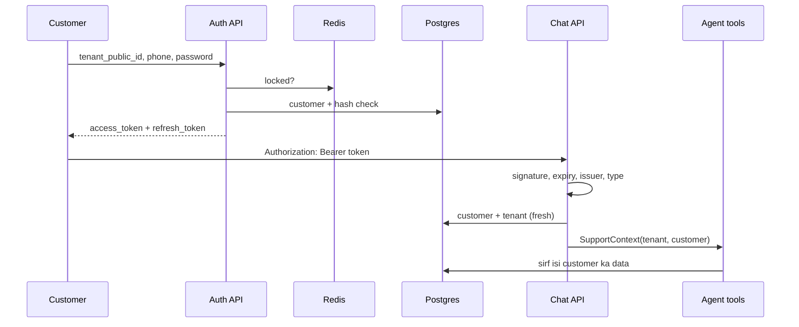

# Walkthrough: `src/apps/accounts/` (Lesson 17)

## Senior ko kisi bhi file ka 5-step jawab
1. **Ek line:** file kya karti hai.
2. **Kaun bulata hai** (caller).
3. **Ye kis ko bulati hai** (imports), group mein.
4. **Main function qadam ba qadam.**
5. **Design ke faisle ("kyun aisa?")** + edge cases.

---

## 1. Ek line
Customer aur staff login karte hain, server ek signed JWT (JSON Web Token) deta hai, aur har API us token se pehchanti hai ke kaun bol raha hai. Agent ko customer isi token se milta hai.

**Hotel ki misal:** reception (login) shanakht dekh kar key card (token) deti hai. Har darwaza (API) card check karta hai, naam poochh kar nahi khulta. Card ek muddat baad band ho jata hai, aur us par sirf reception ki mohar chalti hai.

## 2. Kaun bulata hai
- `config/api.py`: `/api/auth/` router lagata hai.
- `apps/chat/api.py`, `apps/tickets/api.py`: `auth=CustomerJWT()`.
- `apps/tickets/staff_api.py`, `apps/customers/api.py`: `auth=StaffJWT()`.
- `apps/chat/services.py`: `CustomerPrincipal` se `SupportContext` banata hai.



## 3. Ye kis ko bulati hai
- **PyJWT:** `jwt.encode`, `jwt.decode`.
- **Django:** `make_password`, `check_password`, `authenticate`, `User`.
- **django-ninja:** `HttpBearer`.
- **Hamara code:** `Customer`, `normalize_phone`, `infra.cache.login_attempts`, `ratelimit`, `core.limits`.

## 4. Qadam ba qadam

### `tokens.py`
`mint()` claims mein `type`, `iss` (issuer), `iat` (issued at), `exp` (expiry), `jti` (JWT ID) jorta hai aur `JWT_SECRET_KEY` se sign karta hai. `read()` signature, expiry, issuer aur zaroori claims check karta hai, aur type mile to claims deta hai, warna `None`.

### `auth.py`
`principal_from_claims()` role dekhta hai aur customer ya staff DB se laata hai, is shart ke saath ke tenant bhi wahi ho aur active ho. `CustomerJWT` sirf customer ko, `StaffJWT` sirf staff ko aage jane deta hai. `None` ka matlab 401.

### `services/login.py`
`login_customer()`:
1. Phone normalize.
2. Lock check: 5 ghalat koshishon par `LoginLocked` (429).
3. Customer dhoondo.
4. Customer na mile ya password khali ho: `make_password()` wahi slow hash ka kaam karta hai.
5. Hash sahi: failures saaf, tokens wapas.
6. Warna failure gino, `InvalidCredentials` (401).

### `services/passwords.py`
- `sign_up_customer()`: password check, customer + hash ek transaction mein, tokens wapas.
- `change_password()`: purana password check (5 ghalat par lock), naya hash, naye tokens.
- `reset_customer_password()`: staff ka reset; lock bhi khul jata hai.
- `log_out()`: access aur apna refresh token denylist mein.

### Token ke andar
```json
{
  "sub": "customer public id",
  "role": "customer",
  "tenant_public_id": "...",
  "customer_public_id": "...",
  "pwd": "password hash ka keyed fingerprint",
  "type": "access",
  "iss": "opspilot",
  "iat": 1793600000,
  "exp": 1793600900,
  "jti": "..."
}
```
Payload koi bhi parh sakta hai; signature sirf badalne se rokta hai. Is liye token mein password, phone ya email nahi.

## 5. Design ke faisle

| Faisla | Kyun |
|---|---|
| PyJWT seedha | Customers `auth.User` nahi hain; `django-ninja-jwt` User ke hisaab se bana hai aur `django-ninja-extra` bhi laata hai |
| Login mein `tenant_public_id` | Phone sirf company ke andar unique hai |
| Har request par DB se customer | Hata hua customer ya band company ka token foran bekaar |
| Access 15 minute, refresh 7 din | Chori ka nuqsan kam, customer baar baar password na daale |
| Refresh mein naya refresh token nahi | Simple; 7 din baad dobara login |
| Logout par `jti` Redis mein | JWT wapas nahi hota; id expiry tak denylist mein |
| Token mein `pwd` fingerprint | Password badla to us user ke sab tokens khatam |
| Maujood phone par signup 409 | Warna koi bhi staff ke banaye customer ko apna bana leta |
| `algorithms=["HS256"]` fixed | `alg: none` hamla band |
| Ek jaisa error aur utna hi kaam | Kaun se phone maujood hain ye pata na chale |
| Account lock + IP limit | Lock ek account par guessing rokta hai; IP limit ek machine se bohat se phones |
| Redis key mein hash | Phone number Redis mein saaf na likha ho |
| `reviewer` token se | Body mein koi bhi kisi ka naam likh sakta tha |

### Edge cases
- **Password khali:** customer login nahi kar sakta.
- **Staff token se chat:** 401, kyunke staff customer nahi hai.
- **Superuser jis ka `StaffProfile` nahi:** admin chalega, staff API nahi.
- **Lock ka ghalat istemal:** koi kisi ka phone daal kar 30 minute lock karwa sakta hai. Policy ki qeemat hai; OTP se behtar hoga.
- **Logout ek device ka:** doosre device chalte rehte hain; sab band karne ke liye password badlein.
- **Signup mein phone ka saboot nahi:** OTP ke bagair koi bhi kisi ka naya number likh sakta hai.
- **Password bhool jana:** abhi sirf staff reset.
- **Secret leak:** koi bhi kisi ka token bana sakta hai. `JWT_SECRET_KEY` badalne se sab logout ho jate hain.
- **Browser SSE:** `EventSource` header nahi bhej sakta; frontend `fetch` se stream parhe.
- **HTTPS:** production mein zaroori, warna token aur password raaste mein parhe ja sakte hain.

## Kaise check karein
1. Runserver, relay aur worker restart.
2. Postman: *Auth → Customer login (Ali)*, phir *Who am I*.
3. *Security checks* folder: har request apna likha status de.
4. Bina login chat bhejein: 401.
