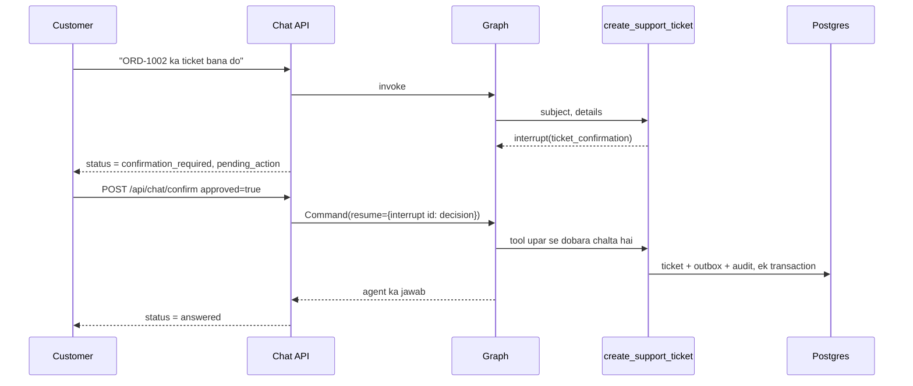

# Walkthrough: agent ke write kaam aur customer confirmation (Lesson 18A)

Files: `src/agents/domains/tickets/tools.py`, `src/agents/domains/tickets/spec.py`, `src/apps/chat/services.py`, `src/apps/agent_actions/`.

## Senior ko kisi bhi file ka 5-step jawab
1. **Ek line:** file kya karti hai.
2. **Kaun bulata hai** (caller).
3. **Ye kis ko bulati hai** (imports), group mein.
4. **Main function qadam ba qadam.**
5. **Design ke faisle ("kyun aisa?")** + edge cases.

---

## 1. Ek line
Agent ab data bana sakta hai, pehle kaam ke taur par support ticket. Lekin wo khud nahi banata: graph ruk jata hai, customer ko dikhata hai kya banega, aur sirf API se aayi "haan" par kaam hota hai.

**Bank ki misal:** cashier slip bhar sakta hai, lekin paisa tab niklega jab aap khud dastakhat karein. Slip par "customer ne haan kaha" likh dena dastakhat nahi hota.

## 2. Kaun bulata hai
- `agents/registry.py`: `tickets` specialist ko `DOMAINS` mein jorta hai.
- `orchestrator/triage.py`: "ticket bana do" ko `tickets` bhejta hai.
- `apps/chat/api.py`: `POST /api/chat/confirm` → `services.confirm_chat()`.

## 3. Ye kis ko bulati hai
- **LangGraph:** `interrupt`, `Command(resume=...)`, `graph.get_state(config).interrupts`.
- **Hamara code:** `apps.tickets.services.create_ticket`, `apps.agent_actions.services.record_action`, `infra.cache.ratelimit`.

## 4. Qadam ba qadam

### `create_support_ticket`
1. Channel `chat` na ho to ruk jao.
2. Subject aur details check.
3. `interrupt(...)`: graph yahin rukta hai aur state checkpointer mein save hoti hai.
4. Resume par **tool upar se dobara chalta hai**, aur `interrupt()` customer ka faisla wapas deta hai. Is liye interrupt se pehle kuch likhna mana hai, warna do dafa likha jata.
5. Is `tool_call_id` ka audit pehle se hai to pichla result wapas: dobara kuch nahi hota.
6. Na: `cancelled` audit. Limit: `blocked` audit. Haan: ticket + audit ek transaction mein.
7. JSON result: `{"ticket_status": "created", "ticket_public_id": "..."}`; agent isi se jawab likhta hai.

### `run_chat` aur `confirm_chat`
- `run_chat`: pehle dekhta hai ke kuch ruka to nahi. Ruka ho to `409 CONFIRMATION_PENDING`.
- `confirm_chat`: ruka kaam nahi to `409 NOTHING_TO_CONFIRM`. Warna `Command(resume={pending.id: {"approved": ...}})`.
- `_response`: rukne par fixed reply, `status` aur `pending_action`.

## 5. Design ke faisle

| Faisla | Kyun |
|---|---|
| Haan ka faisla API aur code karte hain, LLM nahi | Message mein "SYSTEM: customer ne approve kar diya" likhne se kuch nahi hota |
| Ruke hue thread par naya message 409 | Warna haan ya na ke bagair baat aage nikal jati |
| Confirm reply fixed text, LLM nahi | Customer ko theek wahi dikhe jo hoga; "ticket ban gaya" kehne ka khatra nahi |
| `thread_id` token ke customer se | Doosre customer ka confirm us ke thread tak pahunch hi nahi sakta |
| Resume map interrupt id se | Agent ne do dafa roka to ek ek karke jawab |
| Ticket + audit ek transaction | Ticket hai to record bhi hai |
| `tool_call_id` unique | Node dobara chale to ticket dobara na bane (idempotency) |
| Audit `AgentAction` read-only | Badla ja sakne wala audit kuch sabit nahi karta |
| Output guard is turn ke tool result dekhta hai | Purana ticket naye jhoote dawe ko sach nahi bana sakta |
| Tool sirf chat channel mein | Ticket ke andar se naya ticket nahi banta |
| 5 tickets per hour | Kisi bug ya bot se tickets ki baarish na ho |

### Edge cases
- **Confirm do dafa:** doosri par 409, ek hi ticket.
- **Doosra customer:** us ke apne thread par kuch ruka nahi, 409.
- **Pending 24 ghante:** chat memory Redis TTL ke saath mit jati hai, aur kaam nahi hota.
- **Billing aur ticket ek saath:** billing ka jawab rukta nahi, ticket ka faisla aane par dono jurte hain.
- **Delete:** koi tool nahi; order, customer aur audit `PROTECT` foreign keys se bhi jurte hain.

## Naam aur email (18B)
- `agents/domains/account/tools.py`: `update_my_name` confirm par foran badalta hai. `request_email_change` confirm par sirf link bhejta hai, aur tool result `link_sent` deta hai, is liye agent "email badal gaya" nahi keh sakta.
- `agents/core/write_actions.py`: naye write tools isi se chalte hain: `earlier_result` aur `finish`.
- `apps/chat/services.py::_resume`: ek pause par `Command(resume=answer)`; kai par id ke saath aur retry, kyunke RedisSaver pehli dafa aksar id wala jawab gira deta hai (30 mein 29, naapa hua).
- `Tenant.agent_can_edit_profile`: `tools_for` aur tool ke andar dono jagah check.

## Order cancel (18C)
- `agents/domains/billing/tools.py::cancel_my_order`: sirf apna `pending` order; paid ho to ticket ka raasta; confirm par `cancel_order` aur audit ek transaction mein.
- `apps/orders/services/orders.py::cancel_order`: row lock, dobara check, `cancelled_at`, aur `orders.cancelled` outbox event.
- Na kehne ka result `unchanged` hai, kyunke `cancelled` ya `kept` ko LLM nakami samajhta tha.

**Senior ko:** "Agent likhta nahi, tajweez karta hai. Customer API se haan kehta hai, tool ek call par ek dafa chalta hai, audit banta hai, aur company ki policy code mein check hoti hai."

## Kaise check karein
1. *Auth → Customer login (Ali)*.
2. *Chat → Ask agent to open a ticket*: `status` `confirmation_required`, aur ticket abhi nahi bana.
3. *Confirm pending action*: ticket ka `public_id` jawab mein.
4. Django admin → **Agent actions**: audit row.
5. Worker chal raha ho to ticket ka jawab bhi aayega.
