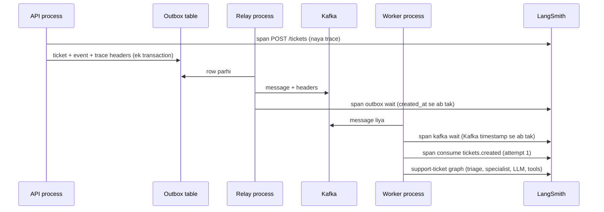

# Walkthrough: Kafka trace context (Lesson 16C)

Files: `src/infra/observability/tracing.py` (span helpers), `src/infra/eventbus/outbox.py`, `src/workers/management/commands/run_outbox_relay.py`, `src/workers/management/commands/run_agent_worker.py`, `src/apps/tickets/api.py`, `src/apps/tickets/staff_api.py`.

## Senior ko kisi bhi file ka 5-step jawab
1. **Ek line:** file kya karti hai.
2. **Kaun bulata hai** (caller).
3. **Ye kis ko bulati hai** (imports), group mein.
4. **Main function qadam ba qadam.**
5. **Design ke faisle ("kyun aisa?")** + edge cases.

---

## 1. Ek line
Pehle ek ticket LangSmith mein sirf worker ke LLM steps dikhata tha. Ab API, outbox, relay, Kafka aur worker **ek hi trace** hain, isliye dikhta hai ke waqt kahan laga: request mein, queue mein, ya LLM mein.

**Courier ki misal:** parcel par ek tracking number lagta hai. Har office (API, relay, worker) apni entry usi number ke neeche likhta hai. Parcel ke andar ka samaan (payload) nahi badalta; tracking number bahar label (Kafka header) par hota hai.

## 2. Kaun bulata hai
- `apps/tickets/api.py::create_ticket` aur `staff_api.py::decide`: `trace_span(...)` se trace shuru karte hain.
- `infra/eventbus/outbox.py::publish_event`: `current_trace_headers()` se headers row mein save karta hai. Is liye `create_ticket` jaisi services ko pata bhi nahi ke tracing hai.
- `run_outbox_relay`: row ke headers Kafka message par lagata hai aur `record_span("outbox wait", ...)` likhta hai.
- `run_agent_worker`: headers parh kar `record_span("kafka wait", ...)` aur har koshish ke liye `trace_span("consume <topic>", parent=headers)`.
- `workers/handlers/tickets.py::_run`: code nahi badla. `trace_config` wala `LangChainTracer` khud current span ko parent bana leta hai.



## 3. Ye kis ko bulati hai
- `langsmith.RunTree`: `from_headers` (doosre process ka parent) aur `to_headers` (agle process ke liye headers).
- `langsmith.run_helpers`: `trace`, `tracing_context`, `get_current_run_tree`.
- `confluent_kafka`: `produce(headers=...)`, `msg.headers()`, `msg.timestamp()`.

## 4. Qadam ba qadam

### Headers kya hain
Do headers hain:
- `langsmith-trace`: dotted order, yani root se is span tak ka raasta (`<waqt><id>.<waqt><id>`). Pehle hisse ka id hi trace id hai.
- `baggage`: project ka naam, tags aur metadata (sirf tenant slug aur public ids, koi naam ya phone nahi).

### `trace_span(name, parent=, metadata=)`
1. Tracing off hai to sirf `yield`: kaam chalta hai, kuch nahi banta.
2. `tracing_context(enabled=True, ...)`: `.env` ki setting `os.environ` mein nahi jati, is liye LangSmith ko batana padta hai ke tracing on hai.
3. `trace(name, parent=_parent_run(...))`: span banata hai. Is ke andar ka har LLM run aur `publish_event` isi ka bacha ban jata hai.
4. Exception aaye to span `error` ban jata hai aur exception waisi hi upar jati hai, taa ke worker ka retry aur DLQ kaam karte rahein.

### `record_span(name, parent=, start_time=)`
Ye un cheezon ke liye hai jo bahar se naapi jati hain: queue mein intezar. Is mein code nahi chalta, sirf shuru aur khatam ka waqt likha jata hai.

**Gotcha:** `from_headers` wale parent ka start time placeholder (abhi) hota hai, aur LangSmith parent se pehle shuru hone wale child ko aage khiska deta hai. Is se wait hamesha 0.00s aata tha. Is liye parent ko bhi wahi `start_time` dete hain.

### Worker mein
```python
trace_headers = {key: value.decode(errors="replace") for key, value in msg.headers() or [] if value}
```
Purane messages par headers nahi hote: `{}` milta hai, naya trace banta hai, kaam chalta rehta hai.

## 5. Design ke faisle

| Faisla | Kyun |
|---|---|
| Headers outbox ki **column** mein, payload mein nahi | Payload business data hai aur uska versioned schema hai. Trace metadata hai. Outbox zaroori hai kyunke API aur relay alag process hain: row hi ek pul hai. |
| `publish_event` ke andar headers uthana | Ek jagah badli, har event ko mil gaya. Services ka code nahi badla. |
| LangSmith ke native headers, OpenTelemetry (OTel) nahi | Senior ka faisla LangSmith hai aur OTel ka koi backend nahi chal raha. Sab kuch `tracing.py` mein band hai, is liye baad mein W3C `traceparent` par jana ek file ka kaam hai. |
| Har attempt ka alag `consume` span | Fail hui koshish trace mein nazar aati hai, dobara koshish ke saath. |
| Staff decision ka **naya trace**, purana nahi | Staff ghanton baad bhi faisla kar sakta hai; ek trace ghanton lamba ho jata. Dono traces `session_id = ticket-<public_id>` se ek Thread mein milte hain. **Trace = ek silsila; Thread = ek ticket ke saare silsile.** |
| DLQ par bhi headers | Mara hua event us request tak wapas dhoonda ja sakta hai jis ne use banaya. |
| Tracing kabhi kaam nahi rokti (fail-open) | Kharab header (maslan `garbage`) par warning aur naya trace. Tracing off par koi span nahi. Monitoring ki wajah se customer ka ticket nahi rukna chahiye. |
| Span mein ticket ka `body` nahi | Customer ka text LangSmith mein sirf graph run se jata hai, jahan masking lagi hai. Headers aur baggage Kafka UI mein bhi nazar aate hain. |

### Edge cases
- **Purani outbox rows / messages:** `headers = {}`, naya trace (migration `eventbus.0002`, default `dict`).
- **Relay band ho:** `outbox wait` span lamba ho jata hai; yahi is span ka faida hai.
- **Duplicate event (`idempotency.is_done`):** skip se pehle return ho jata hai, koi span nahi.
- **Kafka timestamp `-1`:** `kafka wait` nahi likhte.
- **Chat (SSE):** Kafka se nahi guzarta, us ka trace pehle jaisa hai.

## Kaise check karein
1. `.env` mein `LANGSMITH_TRACING=true`, phir runserver, relay aur worker **teeno restart**.
2. Postman se *Create ticket*.
3. LangSmith → project `opspilot-dev` → run `POST /tickets` kholo. Andar `outbox wait`, `kafka wait`, `consume tickets.created` → `support-ticket` hone chahiye.
4. Refund ticket par staff decision do: `POST /staff/tickets/decision` naya trace hai, aur **Threads** mein dono ek `ticket-<public_id>` ke neeche hain.
