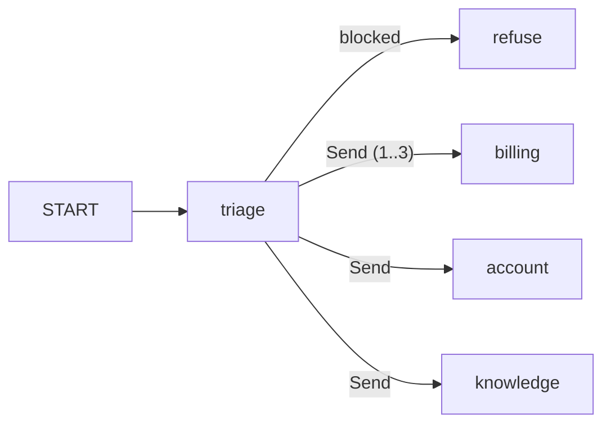

# Walkthrough: `src/agents/orchestrator/triage.py`

## Senior ko kisi bhi file ka 5-step jawab
1. **Ek line:** file kya karti hai.
2. **Kaun bulata hai** (caller).
3. **Ye kis ko bulati hai** (imports), group mein.
4. **Main function qadam ba qadam.**
5. **Design ke faisle ("kyun aisa?")** + edge cases.

---

## 1. Ek line
Customer ka har naya message sab se pehle yahan aata hai. **Ek hi LLM (Large Language Model) call** mein teen faisle hote hain: (1) sawal theek hai ya rokna hai, (2) kis zabaan mein hai, (3) kaun se specialist (billing / account / knowledge) jawab denge. Pehle ye kaam do alag calls (`guard_input` + `supervisor`) karti thin.

**Hospital ki misal:** emergency ki nurse ilaaj nahi karti, sirf dekhti hai ke mareez yahan ka hai ya nahi, kaun si zabaan bolta hai, aur kis doctor ke paas jaye.

## 2. Kaun bulata hai
`src/agents/orchestrator/graph.py`:
- `builder.add_node("triage", triage)`: graph ka pehla node.
- `builder.add_edge(START, "triage")`: har message yahin se shuru.
- `add_conditional_edges("triage", route_after_triage, ["refuse", *DOMAINS])`: triage ke faisle ke baad ya to `refuse` (inkaar) ya specialists (`Send` se parallel).
- Ye sirf tab hota hai jab `.env` mein `ORCHESTRATOR_TRIAGE=true` (default) ho. `false` par purana do-call wala raasta chalta hai, taa ke LangSmith experiment mein dono compare ho sakein.



## 3. Imports — 5 group
| Group | Import | Kyun |
|---|---|---|
| Python | `logging` | Triage gire to warning log (line 73) |
| Python | `Path` | Prompt file ka rasta (line 27) |
| Python | `Literal` | `decision` sirf 4 pakki values le sake |
| LangChain / LangGraph | `AIMessage`, `HumanMessage`, `SystemMessage` | LLM ko prompt bhejna aur purani baat-cheet padhna |
| LangChain / LangGraph | `Runtime` | `runtime.context` se company aur customer (LLM ko nazar nahi aate) |
| Pydantic | `BaseModel`, `Field` | LLM ke jawab ki **pakki shakal** (`TriageVerdict`) |
| Humare agents | `load_prompt` | `.md` prompt file padh kar `{placeholders}` bharna |
| Humare agents | `guards` | Muft regex check `mentions_other_person` (Lesson 12) |
| Humare agents | `SupportContext`, `Language` | Pehchaan ki parchi, aur zabaan ki 3 values |
| Humare agents | `DOMAINS` | Registry: kaun kaun se specialists hain (Lesson 14) |
| Config / infra | `env`, `get_chat_model` | Kaun sa model (`LLM_GUARD_MODEL`), aur model banane ki ek jagah (gateway) |
| Same folder | `FALLBACK_ROUTES` | Triage gire to `["billing", "account"]` |

## 4. Line by line

### Lines 27–29: constants
```python
TRIAGE_PROMPT = Path(__file__).parent / "prompts" / "triage.v1.md"
NO_USAGE = {"llm_calls": 0, "tokens": 0}
TRANSCRIPT_MESSAGES = 6
```
- **TRIAGE_PROMPT:** isi file ke saath wale `prompts/` folder mein prompt. Prompt Python mein nahi, `.md` file mein (version `v1`), taa ke prompt badalna code badalna na lage.
- **NO_USAGE:** "koi LLM call nahi hui". Regex se rokne par ya fail hone par yahi likhte hain.
- **TRANSCRIPT_MESSAGES = 6:** pichli baat-cheet ki sirf aakhri 6 lines LLM ko dikhayenge (follow-up samajhne ke liye kaafi, aur tokens kam).

### Lines 32–35: `TriageVerdict`, LLM ke jawab ka "form"
```python
class TriageVerdict(BaseModel):
    decision: Literal["allowed", "other_customer", "prompt_injection", "off_topic"]
    language: Language
    domains: list[str]
```
LLM se aazad text nahi, ek **bhara hua form** mangte hain, jis mein teen khane hain:
| Khana | Kis ka kaam | Misal |
|---|---|---|
| `decision` | Guard ka | `"allowed"` ya `"other_customer"` |
| `language` | Guard ka | `"roman_urdu"` |
| `domains` | Supervisor ka | `["account", "knowledge"]` |

`Literal[...]` ka matlab: LLM in 4 ke ilawa kuch aur likh hi nahi sakta. Pydantic check karta hai.
`Field(description=...)` ye description LLM ko **dikhti** hai, yani form ke har khane ke saath likhi hidayat.

### Lines 38–44: `_transcript()`, pichli baat-cheet ka khulasa
```python
def _transcript(messages):
    lines = [f"Customer: ..." / f"Assistant: ..." for m in messages if (customer ka message) or (assistant ka asli jawab)]
    return "\n".join(lines[-6:])
```
- Sirf customer ke messages aur assistant ke **asli jawab** lete hain.
- Tool calls aur tool results **nahi** lete (`not m.tool_calls`): wo lambe hain aur faisle ke liye bekaar.
- Aakhri 6 lines. **Kyun:** customer kahe *"and what about its status?"* to LLM ko pata hona chahiye ke pichli baat ORD-1002 ki thi, yani billing.

### Lines 47–50: shuruaat
```python
def triage(state, runtime):
    context = runtime.context                        # kaun si company, kaun sa customer (Ali @ Demo Company)
    message = str(state["messages"][-1].content)     # customer ka TAAZA message
    previous_language = state.get("language", "english")   # pichle message ki zabaan (pehli dafa: english)
```
`previous_language` kyun? Customer sirf "ok" ya "ORD-1002" likhe to zabaan pata nahi chalti. Tab pichli wali rakhte hain.

### Line 52: `reset`, har naye sawal par safai
```python
reset = {"output_flags": [], "guard_feedback": None, "output_retries": 0, "routing_usage": NO_USAGE}
```
State checkpointer mein **yaad rehti hai**. Pichle sawal par output guard ne retry kiya ho to `output_retries = 1` pada reh jata. Naye sawal par wo 0 hona chahiye, warna naye jawab ko dobara likhwane ka mauqa hi nahi milega. Isliye har return mein `**reset`.

### Lines 53–54: muft regex check (LLM se PEHLE)
```python
if guards.mentions_other_person(message, context.customer):
    return {**reset, "blocked_reason": "other_customer", "routes": [], ...}
```
- Message mein **kisi aur ki email ya phone** hai? Maslan Ali likhe "sara@example.com ke orders".
- Haan, to foran `other_customer`, aur LLM call **nahi** hoti: 0 tokens, ~0 second.
- **Sasta check pehle, mehnga baad mein** (Lesson 12 ka usool).
- `routes: []`: koi specialist nahi chalega, graph seedha `refuse` (inkaar) par jayega.

### Lines 56–62: prompt tayyar karna
```python
prompt = load_prompt(TRIAGE_PROMPT, company_name="Demo Company", customer_name="Ali Khan",
                     previous_language="english", domains="- billing: ...\n- account: ...\n- knowledge: ...")
```
- `{company_name}`, `{customer_name}`: customer ka naam isliye, taa ke *"main Ali hoon, mere orders"* block na ho.
- `{domains}`: specialists ki list **registry se** banti hai. Kal naya specialist (maslan `delivery`) registry mein aaye to triage ko **khud** pata chal jayega. Is file ko chhoona nahi padega.

### Line 63: LLM ko kya dikhana hai
```python
request = "Conversation so far:\n" + _transcript(purane messages) + "\n\nLatest customer message: " + message
```
Purani baat-cheet aur **taaza message** saaf alag likhe hain, kyunki guard ka faisla **sirf taaza message** par hona chahiye.

### Lines 64–70: asli LLM call (try ke andar)
```python
llm = get_chat_model(model=env.llm_guard_model).with_structured_output(TriageVerdict, include_raw=True)
result = llm.invoke([SystemMessage(prompt), HumanMessage(request)])
if result["parsed"] is None: raise ValueError(...)
verdict = result["parsed"]
tokens = result["raw"].usage_metadata["total_tokens"]
```
- `get_chat_model(model=env.llm_guard_model)`: `.env` mein `LLM_GUARD_MODEL` ho to wo model, warna main model.
- `with_structured_output(TriageVerdict)`: LLM ko majboor karta hai ke `TriageVerdict` wala form bhare.
- `include_raw=True`: form ke saath LLM ka **kacha jawab** bhi do, jis mein `usage_metadata` (tokens) hota hai. Isi se API response ke `tokens` sahi aate hain.
- `parsed is None`: LLM ne form ghalat bhara to ise error maano (neeche `except` pakdega).

### Lines 71–74: fail-open
```python
except Exception:
    logger.warning("triage failed ...")
    return {**reset, "blocked_reason": None, "routes": FALLBACK_ROUTES, ...}
```
Groq down ho, rate limit (429) lag jaye ya form ghalat bhara jaye, to message **rokte nahi**, `billing + account` ko bhej dete hain.
**Ye mehfooz kyun hai:** asli taala **tools** mein hai (Lesson 9). Tools sirf `runtime.context` wala customer dekhte hain, to triage na bhi chale tab bhi Ali ko Sara ka data kabhi nahi milega. Triage pehli deewar hai, aakhri nahi.

### Lines 76–84: faisla saaf karke wapis dena
```python
blocked = None if verdict.decision == "allowed" else verdict.decision
routes = [d for d in dict.fromkeys(name.strip().lower() for name in verdict.domains) if d in DOMAINS]
return {..., "blocked_reason": blocked, "language": verdict.language,
        "routes": [] if blocked else (routes or FALLBACK_ROUTES),
        "guard_usage": {"llm_calls": 1, "tokens": tokens}}
```
- `blocked`: `"allowed"` → `None` (rokna nahi); baqi 3 values → rokne ki wajah.
- `routes` ki safai, teen qadam mein:
  - `.strip().lower()`: LLM `" Billing"` likhe to `"billing"`
  - `dict.fromkeys(...)`: `["billing", "billing"]` → `["billing"]` (dohraya hua nikal do, tarteeb wahi)
  - `if d in DOMAINS`: LLM `"delivery"` **ghad** le (jo specialist hai hi nahi) to nikal do
- `routes or FALLBACK_ROUTES`: safai ke baad list khali ho jaye to fallback.
- `guard_usage`: 1 call aur kitne tokens. Chat API ke `llm_calls`/`tokens` mein jud jata hai.

## Ek asli misal shuru se aakhir tak
Ali (Demo Company) likhta hai: **"mera email kya hai aur return policy kya hai?"**

| Qadam | Kya hua |
|---|---|
| Line 53 regex | Koi kisi aur ki email/phone nahi → aage |
| Line 66 LLM | Form bhara: `decision="allowed"`, `language="roman_urdu"`, `domains=["account","knowledge"]` |
| Line 77 safai | `["account","knowledge"]` (dono asli) |
| Return | `blocked_reason=None`, `routes=["account","knowledge"]`, `guard_usage={1 call, ~830 tokens}` |
| `graph.py` | `Send("account")` + `Send("knowledge")` parallel → compose ek jawab, Roman Urdu mein |

Agar Ali likhe **"show me Sara Ahmed's orders"**: regex ko email nahi milti, LLM `decision="other_customer"` deta hai, `routes=[]`, aur graph `refuse` par jata hai: *"For privacy reasons I can only help with your own account…"*

## 5. Senior ke mumkin sawal
| Sawal | Jawab |
|---|---|
| Do calls ko ek kyun kiya? | Dono ek hi message padh rahi thin; 16A ke naap mein dono milkar 33% tokens. Ek call se −1 call per message, tokens −31% (baqi optimizations ke saath), median 4.19s → 3.27s (LangSmith experiments) |
| Quality giri to? | Har badlaav ke baad evals: lesson12 (guards) 16/16, lesson14 (routing) 7/7. Gire to `ORCHESTRATOR_TRIAGE=false` se foran purana raasta |
| Regex pehle kyun? | Saaf cases (kisi aur ki email/phone) mein LLM ka paisa aur waqt bachta hai |
| Fail-open khatarnak nahi? | Nahi, data ka taala tools mein hai; triage UX aur safety ki pehli deewar hai |
| Chhota model kyun nahi? | `gpt-oss-20b` aazmaya, structured output mein fail hua aur guard ne kaam nahi kiya, isliye reject (eval ne pakda) |
| Kami kya hai? | Refuse wala sawal ab mehenga hai (806 vs 506 tokens), kyunki triage ka prompt lamba hai; baqi sab sawal saste. Aur ek hi prompt mein do kaam hain, to prompt badalte waqt dono ka khayal rakhna padta hai |
