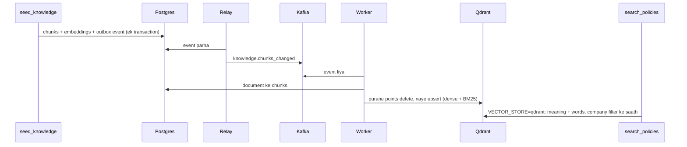

# Walkthrough: Qdrant vector store (Lesson 19A)

Files: `src/infra/vectorstore/qdrant.py`, `src/apps/knowledge/search.py`, `src/apps/knowledge/vector_sync.py`, `src/workers/handlers/knowledge.py`, `src/devtools/management/commands/sync_vectors.py`.

## Senior ko kisi bhi file ka 5-step jawab
1. **Ek line:** file kya karti hai.
2. **Kaun bulata hai** (caller).
3. **Ye kis ko bulati hai** (imports), group mein.
4. **Main function qadam ba qadam.**
5. **Design ke faisle ("kyun aisa?")** + edge cases.

---

## 1. Ek line
Policy search ab do jagah se ho sakti hai: Postgres (pgvector) ya Qdrant, `.env` ke `VECTOR_STORE` switch se. Postgres hi asli data hai; Qdrant us ki search copy hai, jo worker Kafka ke zariye sync rakhta hai.

**Library ki misal:** asli kitabein almari (Postgres) mein hain. Qdrant tez dhoondne wala index card ka dabba hai. Dabba gum ho jaye to almari se dobara bana lo; kitab kabhi sirf dabbe mein nahi hoti.

## 2. Kaun bulata hai
- `agents/domains/knowledge/tools.py::search_policies` → `apps/knowledge/search.py::search_knowledge`.
- `apps/knowledge/services/documents.py`: document bane, badle ya hate to outbox event `knowledge.chunks_changed`.
- `run_agent_worker` ke `ROUTES` → `workers/handlers/knowledge.py` → `vector_sync.sync_document`.
- `uv run src/manage.py sync_vectors`: poori copy dobara.

## 3. Ye kis ko bulati hai
- **qdrant-client 1.19.1** (server `qdrant/qdrant:v1.19.2`): `create_collection`, `create_payload_index`, `upsert`, `delete`, `query_points`.
- **FastEmbed:** dense model (pehle wala, 384) aur naya sparse `Qdrant/bm25`.

## 4. Qadam ba qadam

### Collection `knowledge_chunks`
- **Har point ki ID** chunk ka `public_id` hai.
- **`dense` vector:** 384 dimensions, cosine; Postgres mein jo embedding hai wahi.
- **`bm25` sparse vector:** words aur un ke weight. `Modifier.IDF` kam aane wale lafzon ko zyada wazan deta hai, jaise search engine.
- **Payload:** `tenant`, `document`, `title`, `version`, `section`, `text`.
- **`tenant` index (`is_tenant=True`):** Qdrant har company ke points saath rakhta hai, is liye filter wali search bohat companies ke saath bhi tez rehti hai.

### `sync_document(document_public_id)`
1. Postgres mein document nahi mila: Qdrant se us ke sab points delete.
2. Mila: chunks lo, BM25 vectors banao, purane points delete karo, naye upsert karo.
3. Kitni dafa bhi chalao, Qdrant mein wahi aata hai jo Postgres mein hai (idempotent).

### `search_knowledge`
- `pgvector`: purana `hybrid_search_chunks`, bina badle.
- `qdrant`: do searches (dense aur BM25), dono company ke filter ke andar, phir wahi RRF aur "meaning rank 1 ko extra jagah" wala usool. Natija `Hit` hai, jis ki shakal `KnowledgeChunk` jaisi hai, is liye tool ka baqi code nahi badla.

## 5. Design ke faisle

| Faisla | Kyun |
|---|---|
| Postgres asli, Qdrant copy | Copy ghum ho to `sync_vectors` se wapas; data kabhi sirf Qdrant mein nahi |
| Outbox se sync, seedha nahi | Postgres save ho aur Qdrant fail ho to dono alag ho jate (dual write). Outbox event transaction ke andar likha jata hai |
| Fusion apni, Qdrant ka built-in RRF nahi | Dono stores mein bilkul ek jaisa tareeqa, taa ke muqabla sirf store ka ho; `confident` ke liye har search ka rank bhi chahiye |
| BM25 Qdrant mein | Postgres ka English stemmer `delivery`/`deliver` alag samajhta tha; BM25 ka apna stemmer hai |
| Default `pgvector` | Switch se badalte hain; koi bhi faisla naap kar |
| Admin se document delete band | Wahan se delete karne par event nahi banta, aur Qdrant purana document dhoondta rehta |

### Edge cases
- **`QDRANT_URL` khali:** worker kuch nahi copy karta (`skipped`), aur search pgvector se hoti hai.
- **Qdrant band ho aur event aaye:** worker 3 dafa koshish karta hai, phir event DLQ (`knowledge.chunks_changed.dlq`) mein jata hai. Baad mein `sync_vectors` chala dein.
- **Purane documents:** Lesson 19 se pehle wale documents ka koi event nahi bana, is liye pehli dafa `sync_vectors` zaroori hai.

## Kaise check karein
1. `docker compose up -d qdrant`, phir `http://localhost:6333/dashboard`.
2. `uv run src/manage.py sync_vectors`: "Qdrant has 84 points".
3. `.env` mein `VECTOR_STORE=qdrant`, runserver aur worker restart, phir Postman se koi policy sawal.
